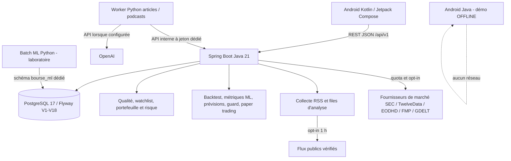

# Architecture unifiée — Bourse AI

> **État** : release candidate de développement mono-utilisateur. Les modules expérimentaux ne sont ni une garantie de rendement ni un outil d'exécution boursière. Ne pas exposer les APIs sur Internet avant authentification et contrôle d'accès par portefeuille.

## Vision générale



## Source de vérité

- **PostgreSQL** est la source de vérité pour les actifs, prix, historique des imports, quotas, portefeuilles et analyses. La base H2 en mémoire n'est utilisée que pour des tests et expériences.
- **Java Spring Boot** est le seul propriétaire des données de l'application principale et des APIs `/api/v1`. Les décisions de scoring restent reproductibles et explicables.
- **Python information worker** récupère le contenu réel via URLs autorisées, puis soumet des résultats structurés au backend via une API interne munie d'un secret distinct. Aucune écriture directe dans les tables `public`.
- **Python ML** est un laboratoire indépendant sur son schéma `bourse_ml`, initialement avec données synthétiques ; aucun modèle entraîné n'est promu automatiquement en production.
- **Kotlin/Compose (`bourse-ai-android`)** est le client mobile principal. Il reste configurable en mode démo; les APIs récentes nécessitent une étape supplémentaire d'adaptation des écrans.
- **`android-demo`** est une application démo Java hors ligne séparée. Elle n'est **pas** l'application mobile de production.

## Trajets de données

1. La watchlist active détermine les symboles US/UE/crypto et les séances à suivre. La collecte est désactivée tant que `MARKET_SCHEDULER_ENABLED=false`.
2. Le collecteur contacte les fournisseurs en respectant quotas et délais ; les observations sont stockées avant agrégation en bougies canoniques.
3. La qualité vérifie OHLCV, cohérence du temps, écarts entre fournisseurs et fraîcheur. Les résultats bloquants empêchent l'analyse.
4. L'information et les podcasts sont collectés séparément et soumis à une revue de preuve avant promotion. La fréquence minimale par source est une heure par défaut.
5. Les règles métiers produisent des métriques distinctes (backtests, relations, corrélations, scores, ML expérimental, forecasts empiriques, risque, guard). **Ne pas confondre ces scores avec des probabilités calibrées.**
6. Le paper trading fonctionne exclusivement en USD fictifs dans son registre propre et **ne transmet aucun ordre à un broker**.
7. Les alertes de recherche sont enregistrées sans envoi externe automatique. Les écrans Android connectés aux API historiques ne sont pas automatiquement reliés à tous les nouveaux modules.

## Contrats et principes de calcul

### Volatilité annualisée

Pour des clôtures adjacentes `P[t-1]`, `P[t]`, le rendement logarithmique est :

```text
r[t] = ln(P[t]/P[t-1])
daily_variance = moyenne(r[t]^2) - moyenne(r[t])^2
vol_annualized = sqrt(max(0, daily_variance)) * sqrt(252)
```

Ce calcul mesure la volatilité **historique**, pas le risque maximal futur. Il suppose une fréquence de 252 séances annuelles et nécessite des cours corrigés des divisions.

### Backtest et prévention des fuites temporelles

Pour une observation à l'index `i` et un horizon `h`, seules les fonctionnalités connues à `i` peuvent être utilisées. Le label de prix `i+h` n'est inclus dans l'entraînement d'un fold que si le label est observable **avant** le début du test.

### Estimations futures

Le module 8 calcule les quantiles historiques des rendements log par horizon sur l'ensemble d'entraînement ; les scénarios sont les quantiles de rang 10%, 50% et 90% appliqués à la dernière clôture. L'intervalle n'est **pas** un intervalle de confiance calibré. La validation calcule la **médiane** réelle des erreurs absolues en pourcentage, comparée à la référence prix inchangé.

### Risque de portefeuille

Pour des quantités fixes `q_i` et prix `P_i(t)` de même devise :

```text
V(t) = Σ_i q_i * P_i(t)
weight_i = q_i * P_i(now) / V(now)
HHI = Σ_i weight_i^2
drawdown = max_t(1 - V(t) / max_{s<=t} V(s))
```

Aucun FX implicite ; les paniers multidevises échouent tant que les conversions horodatées ne sont pas disponibles. La perte empirique au quantile 95% sur 60 rendements est indicative uniquement.

### Opérations simulées

Coût fictif d'un achat = `quantité * clôture + frais`. Une vente crédite `quantité * clôture - frais`. Le frais virtuel du module paper est de 0,10%. Le même `clientOrderId` n'est rejouable que si le symbole, le sens et la quantité correspondent exactement.

## Migration et compatibilité

Les anciennes migrations **V1–V11 sont conservées**, y compris V6–V8 marché/social/calendrier et V9–V11 worker d'information. Les ajouts des modules expérimentaux sont **V12–V18**. Un test démarre d'une base V7 remplie puis applique les migrations jusqu'à V18. Ne renommer ni modifier les migrations déjà appliquées dans une installation existante.

## Démarrage local

Dans le dépôt racine :

```bash
cp .env.example .env
# renseigner DB_PASSWORD
./start.sh
```

Sous Windows PowerShell :

```powershell
Copy-Item .env.example .env
# modifier DB_PASSWORD dans .env
.\start.ps1
```

Requis : JDK 21, Maven 3.9+, Docker avec Compose. Une base PostgreSQL 17 persistante est créée/démarrée sur le port local 5434. Le serveur tourne uniquement sur 127.0.0.1:8081 par défaut. Consulter `http://127.0.0.1:8081/actuator/health`. Ne pas supprimer le volume PostgreSQL pour résoudre un problème de mot de passe.

Pour Android émulateur, `10.0.2.2` peut accéder à l'hôte uniquement si le serveur est accessible sur l'interface correspondante. L'accès depuis un téléphone physique exige un réseau privé, une adresse explicite et **une sécurité serveur supplémentaire**. Aucun secret fournisseur ne doit être intégré dans l'APK.

## Ce qui reste non validé pour la production

- Autorisation utilisateurs et isolation entre portefeuilles, authentification publique, quotas HTTP et protections CSRF/abuse pertinentes.
- Pipeline complet 500 actions, agrégation historique 5 ans de toutes les régions, couverture réelle SEC/PDMR UE et crypto.
- Modèles ML inférables et calibrés sur données réelles, ajustement split/dividendes, factorisation du marché.
- Connexion cohérente de toutes les nouvelles routes aux écrans Kotlin; notifications livrées au smartphone.
- Tests de charge, de sécurité, d'intégration avec des prix réels, de migration sur backup historique et de restauration.

Ces limites ne doivent pas être masquées par une compilation ou une APK de démonstration réussie.
