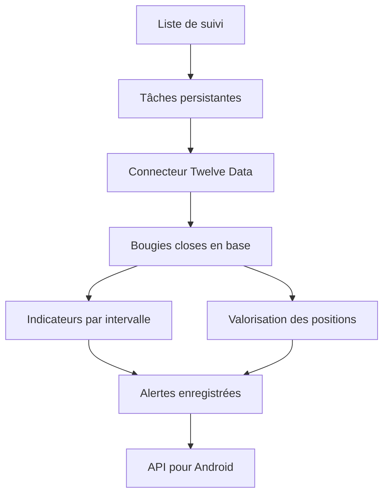

# Complément informations et IA du 21 novembre 2026

La collecte des sources est désormais horaire et le catalogue comprend 12 flux d'actualités et deux podcasts. Les migrations V9 à V11 ajoutent la file persistante, les contenus immuables, les propositions IA, leurs impacts et l'historique des revues. Le [guide du worker](../../bourse-ai-information/README.md) décrit les réglages et les limites actuels. Les paragraphes V8 ci-dessous restent une référence historique ; leur mention « classification à développer » est remplacée pour la proposition IA par ce nouveau module, avec validation opérateur avant contribution.

# Lot 3 — Suivi des marchés, portefeuille et alertes

État du développement au 20 novembre 2026. Cette documentation technique accompagne le code de la branche `feature/portfolio-timeframes-alerts`. Le document d’analyse version 1.2 accompagne cette livraison.

## Ce qui est livré

| Fonction | Comportement implémenté | Limite actuelle |
|---|---|---|
| Liste de suivi | Jusqu’à 100 actions actives et 30 cryptomonnaies actives ; identifiant fournisseur séparé de l’identifiant interne | Aucun univers financier sélectionné automatiquement ; la répartition US/Europe est configurable |
| Séries | Imports et analyses 15m, 30m, 1h et 1d ; 1m historique conservé pour compatibilité | Droits fournisseurs et couverture réelle non validés avec une clé payante |
| Historique EODHD | Paramètre `years` de 1 à 30 ; type STOCK ou CRYPTO | API quotidienne ; import intraday EODHD et pagination longue durée restent à faire |
| Synchronisation récente | Quatre intervalles natifs Twelve Data, timestamps UTC, rejet des bougies en cours | Une page de 5 000 bougies par tâche, sans promesse de 10 ans d’intraday ; volume obligatoire |
| Planification | Liste persistante de tâches, créneaux dédupliqués, bail et reprise, quotas partagés | Désactivée par défaut ; une autorisation fournisseur reste nécessaire ; calendrier US régulier fourni ; autres places à importer |
| Portefeuille | Capital et perte maximale globale, achats, achats supplémentaires, ventes partielles ou totales, frais et FX explicite | Positions longues uniquement, sans vente à découvert ni levier ; déclarations manuelles, aucun ordre courtier |
| Risque global | Valeur du portefeuille, pertes réalisées et latentes, limite globale, données absentes/périmées signalées | Marquage automatique depuis les bougies 15m uniquement quand devise du titre et devise du portefeuille sont identiques |
| Alertes | Seuil global de perte et franchissement MACD baissier selon l’horizon de la position ; dédoublonnage et acquittement | Enregistrées et consultables en REST ; pas encore de notification push sur téléphone |
| Graphiques | API OHLCV chronologique, indicateurs, prix d’achat et scénarios de protection/objectif | Front Android non développé ; objectif 2R illustratif, non calibré ni validé par backtests |
| Collecte RSS et Atom | 12 flux publics institutionnels et de presse, versions, dates et citations attribuées manuellement | Sources désactivées par défaut ; classification sémantique à développer |
| Saisonnière | Mois, trimestres et années sur bougies quotidiennes, contrôle des périodes et échantillons | Statistiques exploratoires ; contribution au score nulle |
| Explication du score | MACD/RSI, variation de marge nette et événements ; preuves, versions et comparaison | Heuristique expérimentale sans probabilité de gain |
| Correctif news | La date GDELT extraite est désormais stockée dans `published_time` | Analyse sémantique et recoupement encore à développer |
| Publications sociales | Comptes suivis, autorité par sujet/date, événements communs, impact et confiance par actif, alertes de réexamen et de retrait | Classification et preuves validées manuellement ; collecteur X facultatif désactivé ; autres collecteurs et score global à développer |

Le module social et son calcul sont détaillés dans [SOCIAL_SIGNALS.md](SOCIAL_SIGNALS.md). Les entrées, preuves et scores sont décrits dans [DATABASE.md](DATABASE.md), migration V7.

## Architecture du traitement



Les tâches sont créées sur des créneaux UTC : une tâche 15m par quart d’heure, 30m par demi-heure, 1h par heure et 1d par journée. Le cycle de production tourne toutes les quinze minutes. Les horaires configurés bloquent les imports intrajournaliers hors séance pour les actions ; les cryptos fonctionnent tous les jours. Les jours fériés et fermetures exceptionnelles ne sont pas encore importés.

Le worker réserve une tâche sous verrou court, libère la transaction avant l’appel HTTP puis mémorise son résultat. La contrainte `(asset_id, timeframe, slot_time)` évite de créer plusieurs fois la même tâche. Une tâche en cours peut être reprise après expiration de son bail de dix minutes ; le stockage des bougies reste idempotent.

Une limite locale de quota produit `DEFERRED` avant l’appel distant. Les erreurs 429 et 502 sont réessayées de manière bornée ; les corps distants et clés API ne sont pas stockés. Les quotas existants sont conservés, sans multiplication artificielle de comptes.

## Indicateurs

`Timeframe` centralise les intervalles et la correspondance avec Twelve Data. Une période 15m signifie une bougie de quinze minutes, jamais un délai de livraison garanti. SMA20, RSI14 et MACD 12/26/9 conservent leurs définitions et utilisent exclusivement les prix de la série demandée.

Une position `SHORT` surveille le MACD 15m, `MEDIUM` le MACD 1h et `LONG` le MACD 1d. Cette première règle produit un avis `MACD_REVIEW`, pas une instruction universelle de vente. Les horizons et règles devront devenir configurables et être validés séparément. Le seuil de risque global reste prioritaire quel que soit l’horizon.

## Comptabilité et risque

```java
cash = initialCapital + somme(cash_delta_base);
equity = cash + somme(quantity * price_quote * fx_to_base);
loss = max(0, initialCapital - equity);
remainingLossBudget = max(0, maxLossAmount - loss);
```

Les mouvements de trésorerie incorporent les frais. Une vente partielle libère une part du coût de revient et enregistre son résultat réalisé ; ce résultat reste inclus dans le capital disponible après la vente. Les taux de change signifient « une unité de devise de cotation vaut combien dans la devise du portefeuille ». Il n’est jamais supposé qu’un dollar vaut un euro.

La limite porte sur la perte nette depuis le capital initial, pas sur une baisse depuis le plus haut historique du portefeuille. Les gains réalisés compensent donc les pertes ultérieures. Les dépôts et retraits après création ne sont pas encore modélisés : ne pas modifier le capital initial pour masquer une perte.

La fraîcheur est déterminée par la dernière bougie attendue dans le calendrier affecté, avec une marge de livraison configurable. Une clôture complète reste une estimation explicite pendant la fermeture et l’attente de la première bougie. Un prix ou un taux FX absent/périmé laisse la perte et le budget indisponibles ; la valeur connue reste consultable. Les erreurs de calendrier et les suspensions sont distinguées. Le taux FX possède un horodatage séparé et une convention de week-end propre.

Le scénario de protection répartit la marge de perte encore disponible proportionnellement à la valeur des positions. Il est indicatif et peut évoluer lors des réévaluations. L’objectif « 2R » illustre un objectif à deux fois la distance entre l’entrée et la protection ; il n’est pas une estimation statistique du prix futur ni un ordre placé.

## Routes disponibles

| Méthode et route | Utilité |
|---|---|
| `PUT /api/v1/watchlist` | Ajouter ou modifier un actif surveillé |
| `GET /api/v1/watchlist` | Lire les actions et cryptos enregistrées |
| `POST /api/v1/watchlist/enqueue` | Créer les tâches du créneau courant |
| `POST /api/v1/market/tasks/run-next` | Traiter une tâche ; peut dépenser un appel fournisseur |
| `GET /api/v1/market/tasks` | Voir les tâches et erreurs sans dépenser de quota |
| `GET /api/v1/charts/{symbol}?timeframe=15m&limit=250` | Bougies closes et derniers indicateurs |
| `GET /api/v1/history/analysis/{symbol}?timeframe=30m` | Analyse indépendante d’un intervalle |
| `POST /api/v1/providers/eodhd/sync/{symbol}?providerSymbol=AAPL.US&years=10&currency=USD` | Historique quotidien étendu, selon les droits du compte |
| `POST /api/v1/portfolios` | Créer un portefeuille et sa limite de perte |
| `POST /api/v1/portfolios/{id}/positions` | Déclarer un achat effectivement exécuté |
| `POST /api/v1/portfolios/{id}/positions/{positionId}/trades` | Déclarer un achat supplémentaire ou une vente |
| `PUT /api/v1/portfolios/{id}/positions/{positionId}/mark` | Fournir un prix et une conversion de devise explicites |
| `POST /api/v1/portfolios/{id}/monitor` | Actualiser les prix de même devise et chercher les alertes |
| `POST /api/v1/portfolios/{id}/evaluate` | Calculer uniquement le risque avec les prix enregistrés |
| `GET /api/v1/portfolios/{id}/positions` | Positions, horizons et quantités restantes |
| `GET /api/v1/portfolios/{id}/positions/{positionId}/plan` | Scénario et repères pour le graphique Android |
| `GET /api/v1/portfolios/{id}/alerts` | Alertes persistantes, avec état de lecture |
| `POST /api/v1/portfolios/{id}/alerts/{alertId}/acknowledge` | Marquer une alerte comme lue |

## Exemple d’utilisation

Les heures ci-dessous sont fictives. Remplacer les identifiants retournés ; les dates d’exécution et d’observation doivent être passées. Les exemples de monnaie EUR n’établissent pas la couverture d’un ticker EUR chez le fournisseur.

```json
// PUT /api/v1/watchlist
{
  "symbol": "AAPL", "name": "Apple", "assetType": "STOCK", "currency": "USD",
  "providerSymbol": "AAPL", "region": "US", "marketZone": "America/New_York",
  "sessionOpen": "09:30", "sessionClose": "16:00", "enabled": true
}
```

```json
// PUT /api/v1/watchlist — identifiant interne sans slash, identifiant fournisseur distinct
{
  "symbol": "BTC-USD", "name": "Bitcoin", "assetType": "CRYPTO", "currency": "USD",
  "providerSymbol": "BTC/USD", "region": "GLOBAL", "marketZone": "UTC",
  "sessionOpen": "00:00", "sessionClose": "23:59", "enabled": true
}
```

```json
// POST /api/v1/portfolios
{"name":"Personnel","baseCurrency":"EUR","initialCapital":1000,"maxLossAmount":100}
```

```json
// POST /api/v1/portfolios/1/positions
{
  "clientOrderId":"achat-unique-001", "symbol":"AAPL", "quantity":2,
  "price":100, "fees":1, "fxToBase":0.9,
  "executedAt":"2026-11-19T14:35:00Z", "horizon":"LONG"
}
```

L’identifiant `clientOrderId` doit être stable lors d’une répétition réseau. Un nouvel achat nécessite un nouvel identifiant. Réutiliser un identifiant avec un prix ou une quantité différente produit un conflit. Les quantités supportent huit décimales, les prix et FX dix ; les mouvements en devise de base sont arrondis à huit décimales.

```json
// PUT /api/v1/portfolios/1/positions/1/mark
{"price":102,"fxToBase":0.92,"observedAt":"2026-11-19T14:50:00Z","source":"MANUAL"}
```

```json
// POST /api/v1/portfolios/1/positions/1/trades — une vente déclarée, pas envoyée au courtier
{
  "clientOrderId":"vente-unique-001", "side":"SELL", "quantity":1,
  "price":103, "fees":0.5, "fxToBase":0.92,
  "executedAt":"2026-11-19T14:55:00Z"
}
```

## Démarrage et validation

Depuis `bourse-ai-engine`, Java 21 et Maven 3.9.x :

```bash
mvn clean test
mvn spring-boot:run -Dspring-boot.run.profiles=postgres
```

Les migrations V6, V7 et V8 s’appliquent automatiquement avec Flyway. Les migrations V1 à V5 ne sont pas modifiées. La planification reste arrêtée tant que `MARKET_SCHEDULER_ENABLED` n’est pas `true`. Le profil PostgreSQL et les variables de connexion doivent être chargés selon `CONFIGURATION.md`. La collecte X reste indépendante, désactivée par défaut, sans planification dans ce lot.

Pour activer volontairement les appels périodiques : renseigner la clé Twelve Data, vérifier les marchés et quotas, puis définir `MARKET_SCHEDULER_ENABLED=true`. Le rythme de traitement dépend de `MARKET_WORKER_DELAY_MS` et des limites locales. Avec une offre gratuite, des tâches peuvent rester différées ; le logiciel ne garantit pas la couverture des 130 actifs toutes les quinze minutes.

## Travail restant

1. Valider le fournisseur pour 100 actions majoritairement américaines et 30 cryptos, le coût récurrent, les licences et la fraîcheur des données.
2. Ajouter l’historique intraday long, les corrections de cours et opérations sur titres ; étendre les calendriers aux autres places et séances particulières.
3. Automatiser les taux de change et qualifier les calendriers/horaires des fournisseurs FX ; l’horodatage explicite et le contrôle de validité sont livrés.
4. Définir et tester les règles de protection, cibles de prix et ventes selon les horizons ; ajouter des backtests sans anticipation, frais et glissement inclus.
5. Intégrer le correctif podcasts, automatiser la classification des textes et valider indépendamment les nouvelles règles explicatives.
   Les événements structurés, la collecte RSS et la combinaison explicative sont présents ; la corroboration automatique, les collecteurs sociaux supplémentaires et le calibrage restent à faire.
6. Développer le front Android, les graphiques interactifs et les notifications push, avec authentification avant exposition réseau.

Aucune performance d’investissement n’est démontrée par ces tests logiciels. Aucun ordre de marché n’est transmis. Le budget de perte est un déclencheur de suivi et ne garantit pas un plafond d’exécution réel.

## Modules et configuration du lot V8

Le [guide local complet](BACKEND_LOCAL.md) couvre les calendriers, la saisonnalité, les flux, la validation des paroles et les versions de règles. Les explications sont accessibles à `/api/v1/explanations/{symbol}` pour DAY, MONTH ou YEAR ; l’ancienne route `/api/v1/investment/explain/{symbol}` est conservée pour compatibilité. Les [résultats de validation](VALIDATION.md) distinguent tests automatiques, sources réelles et limites restantes.
