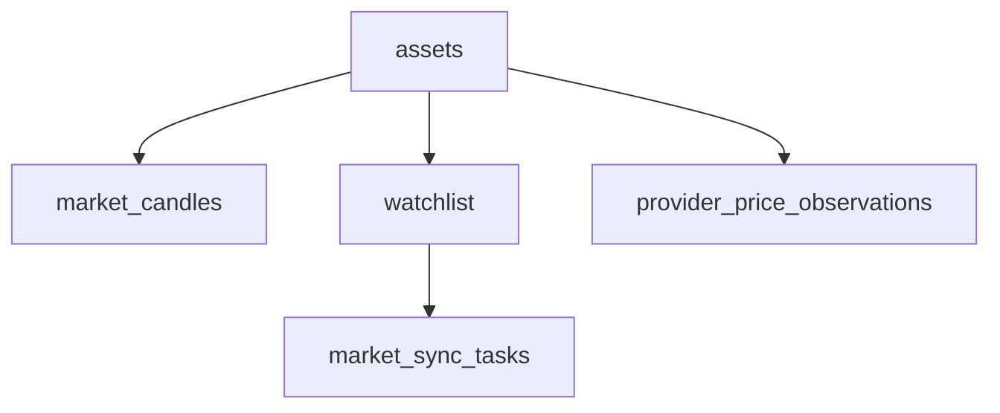
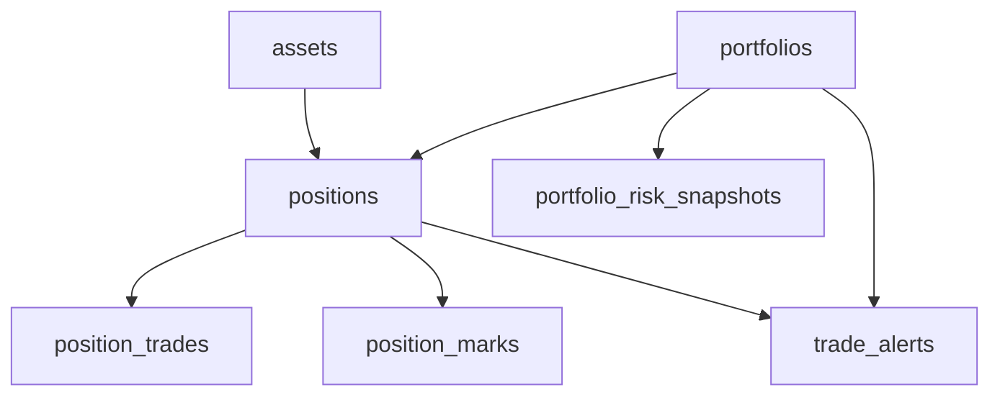
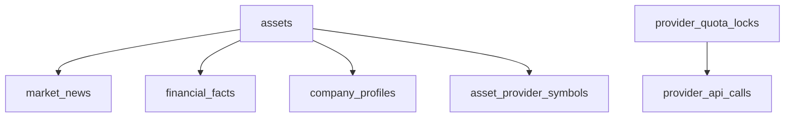

# Base de données Bourse AI

Schéma réel après application de Flyway V1 à V6 sur PostgreSQL 17.7, le 19 novembre 2026. Les 19 tables et 179 colonnes ci-dessous sont extraites de cette base de test ; leur rôle correspond au code livré. Le document d’analyse Word/PDF reste inchangé.

## Données de marché

Un actif possède plusieurs bougies. Les observations par fournisseur conservent leur provenance ; la série canonique est celle utilisée pour les calculs. La liste de suivi crée des tâches d’import pour chaque intervalle, sans recopier les caractéristiques de l’actif.

## Portefeuille et suivi

Une position décrit ce qui reste détenu. Les achats et ventes sont conservés séparément dans le journal, tandis que la dernière valorisation sert au calcul du risque. Une vente ne supprime jamais ses pertes réalisées du portefeuille.

## Informations et quotas

Les tables existantes V1 à V5 sont conservées. V6 ajoute le suivi, les positions et les alertes, ainsi qu’un verrou technique de capacité. Aucun mot de passe ni token fournisseur n’est stocké dans ces tables.

## Conventions

- Les prix et sommes utilisent des types décimaux, jamais des nombres flottants binaires.
- Les dates sont stockées comme instants UTC ; les horaires de marché utilisent un fuseau IANA distinct.
- `base` désigne la devise du portefeuille ; `quote` la devise de cotation de l’actif.
- Les colonnes d’audit décrivent le stockage ; elles ne remplacent pas la date de marché, de publication ou d’exécution.
- La colonne « obligatoire » indique la contrainte NOT NULL. Les clés et contraintes composées sont précisées sous chaque table.
- Aucun DELETE en cascade n’est défini pour les journaux financiers. Les corrections d’exécutions passées et les dépôts/retraits après création restent à développer.

## Dictionnaire des colonnes

### assets

Référentiel commun des actions et cryptomonnaies.

| Colonne | Type PostgreSQL | Obligatoire | Signification |
|---|---|---|---|
| `id` | `bigint` | Oui | Clé primaire de l’actif ; utilisée par prix, actualités, suivi et positions. |
| `symbol` | `character varying(40)` | Oui | Identifiant interne unique ; un code de place dans le symbole évite les collisions. |
| `name` | `character varying(255)` | Oui | Nom lisible affiché à l’utilisateur. |
| `asset_type` | `character varying(16)` | Oui | STOCK ou CRYPTO ; aucun type FOREX de portefeuille dans ce lot. |
| `currency` | `character varying(3)` | Oui | Devise de cotation à trois lettres, à distinguer de la devise du portefeuille. |
| `created_time` | `timestamp with time zone` | Oui | Date technique de création de l’enregistrement, en UTC. |
| `updated_time` | `timestamp with time zone` | Oui | Date de dernière modification écrite par le service ; aucun trigger global automatique. |

Clé primaire `id`, unicité de `symbol`. Deux titres homonymes de places différentes doivent recevoir des symboles internes distincts.

### market_candles

Séries OHLCV canoniques utilisées par les indicateurs et les graphiques.

| Colonne | Type PostgreSQL | Obligatoire | Signification |
|---|---|---|---|
| `id` | `bigint` | Oui | Identifiant technique généré par la base, sauf pour les tables de verrou. |
| `asset_id` | `bigint` | Oui | Référence vers assets.id ; identifie l’instrument sans répéter ses caractéristiques. |
| `timeframe` | `character varying(8)` | Oui | Durée de bougie : 1m, 15m, 30m, 1h ou 1d selon la route. |
| `open_time` | `timestamp with time zone` | Oui | Début de la bougie en UTC ; distinct de sa date de réception. |
| `open_price` | `numeric(24,10)` | Oui | Prix d’ouverture dans la devise de cotation. |
| `high_price` | `numeric(24,10)` | Oui | Prix le plus haut de la bougie dans la devise de cotation. |
| `low_price` | `numeric(24,10)` | Oui | Prix le plus bas de la bougie dans la devise de cotation. |
| `close_price` | `numeric(24,10)` | Oui | Prix de clôture de la bougie dans la devise de cotation. |
| `volume` | `numeric(28,8)` | Oui | Volume déclaré par la source ; ne pas remplacer une donnée absente par zéro. |
| `provider` | `character varying(64)` | Oui | Nom du fournisseur ou de la provenance technique. |
| `created_time` | `timestamp with time zone` | Oui | Date technique de création de l’enregistrement, en UTC. |
| `updated_time` | `timestamp with time zone` | Oui | Date de dernière modification écrite par le service ; aucun trigger global automatique. |

Unicité `(asset_id, timeframe, open_time)`. Contrôles SQL des prix positifs et OHLC cohérents. Un réimport ignore les bougies déjà présentes ; la correction des historiques reste à implémenter.

### watchlist

Actifs à suivre, symboles Twelve Data et horaires réguliers de séance.

| Colonne | Type PostgreSQL | Obligatoire | Signification |
|---|---|---|---|
| `asset_id` | `bigint` | Oui | Référence vers assets.id ; identifie l’instrument sans répéter ses caractéristiques. |
| `provider_symbol` | `character varying(80)` | Oui | Symbole compris par ce fournisseur ; peut différer du symbole interne. |
| `region` | `character varying(12)` | Oui | US, EU ou GLOBAL ; information de couverture, pas un score financier. |
| `market_zone` | `character varying(80)` | Oui | Fuseau IANA de la séance, par exemple America/New_York ; gère les changements d’heure. |
| `session_open` | `character varying(5)` | Oui | Début de la séance régulière au format HH:mm, heure locale du marché. |
| `session_close` | `character varying(5)` | Oui | Fin exclusive de la séance régulière ; non utilisée pour les cryptos. |
| `enabled` | `boolean` | Oui | Active ou désactive la production de tâches pour cet actif. |
| `created_time` | `timestamp with time zone` | Oui | Date technique de création de l’enregistrement, en UTC. |
| `updated_time` | `timestamp with time zone` | Oui | Date de dernière modification écrite par le service ; aucun trigger global automatique. |

Clé primaire `asset_id`. Plafonds applicatifs : 100 actions actives et 30 cryptos actives. Le calendrier gère les jours de semaine et fuseaux, sans jours fériés ni demi-séances.

### market_sync_tasks

File persistante de synchronisation avec états, tentatives et bail de reprise.

| Colonne | Type PostgreSQL | Obligatoire | Signification |
|---|---|---|---|
| `id` | `bigint` | Oui | Identifiant technique généré par la base, sauf pour les tables de verrou. |
| `asset_id` | `bigint` | Oui | Référence vers assets.id ; identifie l’instrument sans répéter ses caractéristiques. |
| `timeframe` | `character varying(8)` | Oui | Durée de bougie : 1m, 15m, 30m, 1h ou 1d selon la route. |
| `slot_time` | `timestamp with time zone` | Oui | Créneau UTC d’import ; sert avec actif et intervalle à dédupliquer la tâche. |
| `status` | `character varying(20)` | Oui | État métier ou technique, dont les valeurs sont précisées sous la table. |
| `attempts` | `integer` | Oui | Nombre de prises en charge, y compris celles ensuite différées par quota. |
| `next_attempt_at` | `timestamp with time zone` | Oui | Instant minimal pour une prochaine tentative. |
| `lease_until` | `timestamp with time zone` | Non | Expiration du bail de traitement, qui permet la reprise après interruption. |
| `error_code` | `character varying(80)` | Non | Code local assaini, par exemple LOCAL_QUOTA ou HTTP_502. |
| `imported_count` | `integer` | Oui | Nombre de bougies nouvelles lors de la dernière exécution réussie. |
| `created_time` | `timestamp with time zone` | Oui | Date technique de création de l’enregistrement, en UTC. |
| `updated_time` | `timestamp with time zone` | Oui | Date de dernière modification écrite par le service ; aucun trigger global automatique. |

États : PENDING, RUNNING, DEFERRED, SUCCEEDED, FAILED. Unicité `(asset_id, timeframe, slot_time)`. Le bail est un mécanisme de reprise ; la déduplication finale des bougies reste nécessaire.

### portfolios

Capital initial, devise de référence et limite de perte globale.

| Colonne | Type PostgreSQL | Obligatoire | Signification |
|---|---|---|---|
| `id` | `bigint` | Oui | Identifiant technique généré par la base, sauf pour les tables de verrou. |
| `name` | `character varying(120)` | Oui | Nom lisible affiché à l’utilisateur. |
| `base_currency` | `character varying(3)` | Oui | Devise commune utilisée pour le capital, la trésorerie et les limites. |
| `initial_capital` | `numeric(24,8)` | Oui | Capital de référence initial ; les dépôts/retraits ultérieurs ne sont pas encore modélisés. |
| `max_loss_amount` | `numeric(24,8)` | Oui | Perte nette maximale de référence en devise de base ; ce n’est pas une garantie d’exécution. |
| `risk_latched` | `boolean` | Oui | Mémorise une alerte de perte déjà émise ; réarmé après retour à un état sain. |
| `created_time` | `timestamp with time zone` | Oui | Date technique de création de l’enregistrement, en UTC. |
| `updated_time` | `timestamp with time zone` | Oui | Date de dernière modification écrite par le service ; aucun trigger global automatique. |

Le budget est global et exprimé en devise de base. La référence est le capital initial, pas le plus haut historique atteint.

### positions

Quantités restantes et coût de revient d’une position déclarée.

| Colonne | Type PostgreSQL | Obligatoire | Signification |
|---|---|---|---|
| `id` | `bigint` | Oui | Identifiant technique généré par la base, sauf pour les tables de verrou. |
| `portfolio_id` | `bigint` | Oui | Référence vers portfolios.id ; rattache la donnée au portefeuille. |
| `asset_id` | `bigint` | Oui | Référence vers assets.id ; identifie l’instrument sans répéter ses caractéristiques. |
| `quantity` | `numeric(28,8)` | Oui | Nombre de titres ou unités de crypto ; fractions possibles sur huit décimales. |
| `average_entry_quote` | `numeric(24,10)` | Oui | Moyenne pondérée des prix d’achat, hors frais, dans la devise de l’actif. |
| `remaining_cost_base` | `numeric(24,8)` | Oui | Coût de revient des unités restantes en devise de base, frais d’achat inclus. |
| `horizon` | `character varying(12)` | Oui | SHORT, MEDIUM ou LONG ; sélectionne l’unité de temps du signal de révision. |
| `signal_timeframe` | `character varying(8)` | Oui | 15m pour SHORT, 1h pour MEDIUM et 1d pour LONG dans cette version. |
| `opened_at` | `timestamp with time zone` | Oui | Date et heure du premier achat déclaré de cette position. |
| `status` | `character varying(12)` | Oui | État métier ou technique, dont les valeurs sont précisées sous la table. |
| `created_time` | `timestamp with time zone` | Oui | Date technique de création de l’enregistrement, en UTC. |
| `updated_time` | `timestamp with time zone` | Oui | Date de dernière modification écrite par le service ; aucun trigger global automatique. |

États OPEN ou CLOSED. Une quantité nulle clôture la position ; la ligne et son historique sont conservés.

### position_trades

Journal immuable des achats et ventes déclarés, frais, FX et trésorerie.

| Colonne | Type PostgreSQL | Obligatoire | Signification |
|---|---|---|---|
| `id` | `bigint` | Oui | Identifiant technique généré par la base, sauf pour les tables de verrou. |
| `position_id` | `bigint` | Oui | Référence vers positions.id ; peut être absent pour une alerte globale. |
| `portfolio_id` | `bigint` | Oui | Référence vers portfolios.id ; rattache la donnée au portefeuille. |
| `client_order_id` | `character varying(80)` | Oui | Identifiant client stable et unique dans le portefeuille ; évite les doubles saisies réseau. |
| `side` | `character varying(4)` | Oui | BUY ou SELL ; déclaration d’une exécution, aucun ordre transmis au courtier. |
| `quantity` | `numeric(28,8)` | Oui | Nombre de titres ou unités de crypto ; fractions possibles sur huit décimales. |
| `price_quote` | `numeric(24,10)` | Oui | Prix unitaire dans la devise de cotation de l’actif. |
| `fees_quote` | `numeric(24,10)` | Oui | Frais de cette opération dans la devise de cotation ; montant positif ou nul. |
| `fx_to_base` | `numeric(24,10)` | Oui | Valeur d’une unité de devise de cotation dans la devise du portefeuille ; 1 si identiques. |
| `cash_delta_base` | `numeric(24,8)` | Oui | Mouvement de trésorerie net en devise de base ; négatif à l’achat, positif à la vente. |
| `realized_pnl_base` | `numeric(24,8)` | Oui | Résultat réalisé net de la quantité vendue selon le coût moyen ; nul pour un achat. |
| `executed_at` | `timestamp with time zone` | Oui | Instant de l’exécution déclarée ; ne peut pas précéder l’opération précédente. |
| `created_time` | `timestamp with time zone` | Oui | Date technique de création de l’enregistrement, en UTC. |

Unicité `(portfolio_id, client_order_id)`. Les achats sont limités à la trésorerie disponible et les ventes à la quantité détenue ; aucune suppression par cascade des données financières.

### position_marks

Dernier prix et conversion explicites utilisés pour valoriser une position.

| Colonne | Type PostgreSQL | Obligatoire | Signification |
|---|---|---|---|
| `position_id` | `bigint` | Oui | Référence vers positions.id ; peut être absent pour une alerte globale. |
| `price_quote` | `numeric(24,10)` | Oui | Prix unitaire dans la devise de cotation de l’actif. |
| `fx_to_base` | `numeric(24,10)` | Oui | Valeur d’une unité de devise de cotation dans la devise du portefeuille ; 1 si identiques. |
| `observed_at` | `timestamp with time zone` | Oui | Instant du prix de marché utilisé ; ne doit pas être remplacé par l’heure de téléchargement. |
| `source` | `character varying(64)` | Oui | Source ou provenance de la valeur, sans clé API ni URL secrète. |
| `updated_time` | `timestamp with time zone` | Oui | Date de dernière modification écrite par le service ; aucun trigger global automatique. |

Clé primaire `position_id` : une valeur courante par position. Les mises à jour antérieures au dernier prix sont refusées. Le FX reste explicite ; aucune parité EUR/USD implicite.

### portfolio_risk_snapshots

Historique des évaluations de risque et des éventuels manques de données.

| Colonne | Type PostgreSQL | Obligatoire | Signification |
|---|---|---|---|
| `id` | `bigint` | Oui | Identifiant technique généré par la base, sauf pour les tables de verrou. |
| `portfolio_id` | `bigint` | Oui | Référence vers portfolios.id ; rattache la donnée au portefeuille. |
| `evaluated_at` | `timestamp with time zone` | Oui | Instant auquel le calcul de risque a été réalisé. |
| `status` | `character varying(32)` | Oui | État métier ou technique, dont les valeurs sont précisées sous la table. |
| `cash_base` | `numeric(24,8)` | Oui | Capital initial plus mouvements nets de trésorerie. |
| `known_equity_base` | `numeric(24,8)` | Oui | Trésorerie et valeurs connues ; reste partielle si des prix sont absents. |
| `loss_base` | `numeric(24,8)` | Non | Perte nette depuis le capital initial ; NULL si des prix sont absents ou périmés. |
| `missing_marks` | `integer` | Oui | Nombre de positions ouvertes sans valorisation. |
| `stale_marks` | `integer` | Oui | Nombre de valorisations vieilles de plus de vingt minutes. |
| `created_time` | `timestamp with time zone` | Oui | Date technique de création de l’enregistrement, en UTC. |

États : OK, DATA_INCOMPLETE, STALE_DATA ou LOSS_LIMIT_REACHED. Une perte NULL ne signifie jamais zéro perte.

### trade_alerts

Avis de révision ou alerte globale, conservés jusqu’à consultation et acquittement.

| Colonne | Type PostgreSQL | Obligatoire | Signification |
|---|---|---|---|
| `id` | `bigint` | Oui | Identifiant technique généré par la base, sauf pour les tables de verrou. |
| `portfolio_id` | `bigint` | Oui | Référence vers portfolios.id ; rattache la donnée au portefeuille. |
| `position_id` | `bigint` | Non | Référence vers positions.id ; peut être absent pour une alerte globale. |
| `event_key` | `character varying(180)` | Oui | Clé unique de dédoublonnage de l’événement ou de l’épisode de dépassement. |
| `alert_type` | `character varying(40)` | Oui | LOSS_LIMIT ou MACD_REVIEW dans cette version. |
| `message` | `character varying(1500)` | Oui | Motif explicatif destiné à l’interface ; n’exécute pas de vente. |
| `data_time` | `timestamp with time zone` | Oui | Date des données qui ont déclenché l’avis. |
| `status` | `character varying(20)` | Oui | État métier ou technique, dont les valeurs sont précisées sous la table. |
| `created_time` | `timestamp with time zone` | Oui | Date technique de création de l’enregistrement, en UTC. |
| `updated_time` | `timestamp with time zone` | Oui | Date de dernière modification écrite par le service ; aucun trigger global automatique. |

États NEW ou ACKNOWLEDGED. Les alertes restent consultables par l’API ; l’envoi push Android n’est pas encore connecté.

### market_news

Titres et liens d’actualités associés aux actifs, avec leur sentiment simple.

| Colonne | Type PostgreSQL | Obligatoire | Signification |
|---|---|---|---|
| `id` | `bigint` | Oui | Identifiant technique généré par la base, sauf pour les tables de verrou. |
| `asset_id` | `bigint` | Oui | Référence vers assets.id ; identifie l’instrument sans répéter ses caractéristiques. |
| `source` | `character varying(120)` | Oui | Source ou provenance de la valeur, sans clé API ni URL secrète. |
| `title` | `character varying(1500)` | Oui | Titre de l’article ; le texte complet n’est pas conservé par ce connecteur. |
| `url` | `character varying(2000)` | Oui | Lien de l’article ; unique pour un actif donné. |
| `published_time` | `timestamp with time zone` | Non | Date de publication disponible chez la source, éventuellement absente. |
| `seen_time` | `timestamp with time zone` | Oui | Date technique de première collecte ; ne remplace pas la date de publication. |
| `sentiment_score` | `integer` | Non | -1, 0 ou +1 selon les mots clés reconnus dans le titre. |
| `sentiment_method` | `character varying(64)` | Non | Version de méthode, actuellement KEYWORDS_V1 après analyse. |
| `created_time` | `timestamp with time zone` | Oui | Date technique de création de l’enregistrement, en UTC. |
| `updated_time` | `timestamp with time zone` | Oui | Date de dernière modification écrite par le service ; aucun trigger global automatique. |
| `source_country` | `character varying(10)` | Non | Pays déclaré par la source, tronqué à la taille existante du champ. |
| `language` | `character varying(20)` | Non | Langue annoncée par le fournisseur. |
| `region_tag` | `character varying(20)` | Non | Champ prévu pour le classement régional, pas automatiquement renseigné aujourd’hui. |

Unicité `(asset_id, url)`. La date GDELT publiée est conservée lorsqu’elle existe.

### financial_facts

Faits comptables SEC avec période, unité et dépôt source.

| Colonne | Type PostgreSQL | Obligatoire | Signification |
|---|---|---|---|
| `id` | `bigint` | Oui | Identifiant technique généré par la base, sauf pour les tables de verrou. |
| `asset_id` | `bigint` | Oui | Référence vers assets.id ; identifie l’instrument sans répéter ses caractéristiques. |
| `concept` | `character varying(120)` | Oui | Concept comptable SEC, par exemple revenu ou bénéfice. |
| `value` | `numeric(30,4)` | Oui | Valeur du concept dans l’unité indiquée ; ce n’est pas nécessairement une somme monétaire. |
| `unit` | `character varying(24)` | Oui | Unité déclarée, par exemple USD ou shares. |
| `period_start` | `date` | Non | Début de la période comptable, si pertinent. |
| `period_end` | `date` | Oui | Fin de la période comptable mesurée. |
| `filed_date` | `date` | Oui | Date de dépôt du document ; importante pour éviter l’anticipation en backtest. |
| `form_type` | `character varying(20)` | Oui | Type de dépôt, par exemple 10-K ou 10-Q. |
| `accession_number` | `character varying(32)` | Oui | Identifiant du dépôt SEC source ; distingue les versions déclarées. |
| `source` | `character varying(40)` | Oui | Source ou provenance de la valeur, sans clé API ni URL secrète. |
| `created_time` | `timestamp with time zone` | Oui | Date technique de création de l’enregistrement, en UTC. |
| `updated_time` | `timestamp with time zone` | Oui | Date de dernière modification écrite par le service ; aucun trigger global automatique. |

Unicité `(asset_id, concept, accession_number, period_end, unit)` pour distinguer les dépôts et unités.

### company_profiles

Profil descriptif de chaque société, distinct des comptes financiers.

| Colonne | Type PostgreSQL | Obligatoire | Signification |
|---|---|---|---|
| `asset_id` | `bigint` | Oui | Référence vers assets.id ; identifie l’instrument sans répéter ses caractéristiques. |
| `company_name` | `character varying(255)` | Non | Nom de société communiqué par la source. |
| `exchange_name` | `character varying(120)` | Non | Nom de la place communiqué par la source. |
| `sector` | `character varying(120)` | Non | Secteur d’activité déclaré. |
| `industry` | `character varying(200)` | Non | Sous-secteur ou industrie déclarée. |
| `website` | `character varying(500)` | Non | Site de la société. |
| `market_cap` | `numeric(30,2)` | Non | Capitalisation communiquée par la source ; unité et date à contrôler avant comparaison. |
| `source` | `character varying(40)` | Oui | Source ou provenance de la valeur, sans clé API ni URL secrète. |
| `fetched_time` | `timestamp with time zone` | Oui | Date de récupération de ce profil. |
| `created_time` | `timestamp with time zone` | Oui | Date technique de création de l’enregistrement, en UTC. |
| `updated_time` | `timestamp with time zone` | Oui | Date de dernière modification écrite par le service ; aucun trigger global automatique. |

Clé primaire `asset_id` : au plus un profil courant par actif.

### asset_provider_symbols

Correspondance entre identifiant interne et symbole de chaque fournisseur.

| Colonne | Type PostgreSQL | Obligatoire | Signification |
|---|---|---|---|
| `asset_id` | `bigint` | Oui | Référence vers assets.id ; identifie l’instrument sans répéter ses caractéristiques. |
| `provider` | `character varying(40)` | Oui | Nom du fournisseur ou de la provenance technique. |
| `provider_symbol` | `character varying(80)` | Oui | Symbole compris par ce fournisseur ; peut différer du symbole interne. |
| `exchange_mic` | `character varying(12)` | Non | Identifiant de place MIC quand disponible ; champ facultatif. |
| `created_time` | `timestamp with time zone` | Oui | Date technique de création de l’enregistrement, en UTC. |
| `updated_time` | `timestamp with time zone` | Oui | Date de dernière modification écrite par le service ; aucun trigger global automatique. |

Clé primaire composée `(asset_id, provider)`.

### provider_price_observations

Observations distinctes par fournisseur pour la provenance et la comparaison.

| Colonne | Type PostgreSQL | Obligatoire | Signification |
|---|---|---|---|
| `id` | `bigint` | Oui | Identifiant technique généré par la base, sauf pour les tables de verrou. |
| `asset_id` | `bigint` | Oui | Référence vers assets.id ; identifie l’instrument sans répéter ses caractéristiques. |
| `provider` | `character varying(40)` | Oui | Nom du fournisseur ou de la provenance technique. |
| `provider_symbol` | `character varying(80)` | Oui | Symbole compris par ce fournisseur ; peut différer du symbole interne. |
| `timeframe` | `character varying(8)` | Oui | Durée de bougie : 1m, 15m, 30m, 1h ou 1d selon la route. |
| `open_time` | `timestamp with time zone` | Oui | Début de la bougie en UTC ; distinct de sa date de réception. |
| `open_price` | `numeric(24,10)` | Oui | Prix d’ouverture dans la devise de cotation. |
| `high_price` | `numeric(24,10)` | Oui | Prix le plus haut de la bougie dans la devise de cotation. |
| `low_price` | `numeric(24,10)` | Oui | Prix le plus bas de la bougie dans la devise de cotation. |
| `close_price` | `numeric(24,10)` | Oui | Prix de clôture de la bougie dans la devise de cotation. |
| `volume` | `numeric(28,8)` | Oui | Volume déclaré par la source ; ne pas remplacer une donnée absente par zéro. |
| `currency` | `character varying(3)` | Oui | Devise de cotation à trois lettres, à distinguer de la devise du portefeuille. |
| `price_adjustment` | `character varying(30)` | Oui | Convention d’ajustement ; UNSPECIFIED tant qu’elle n’a pas été qualifiée. |
| `created_time` | `timestamp with time zone` | Oui | Date technique de création de l’enregistrement, en UTC. |
| `updated_time` | `timestamp with time zone` | Oui | Date de dernière modification écrite par le service ; aucun trigger global automatique. |

Unicité `(asset_id, provider, timeframe, open_time)` ; les alternatives ne sont pas mélangées silencieusement dans la série canonique.

### import_jobs

Journal des tentatives d’import par fournisseur et jeu de données.

| Colonne | Type PostgreSQL | Obligatoire | Signification |
|---|---|---|---|
| `id` | `bigint` | Oui | Identifiant technique généré par la base, sauf pour les tables de verrou. |
| `asset_symbol` | `character varying(40)` | Oui | Symbole demandé, conservé même si la création de l’actif échoue. |
| `provider` | `character varying(50)` | Oui | Nom du fournisseur ou de la provenance technique. |
| `dataset` | `character varying(50)` | Oui | Jeu de données ou intervalle demandé, par exemple DAILY_OHLCV ou 15m_OHLCV. |
| `status` | `character varying(20)` | Oui | État métier ou technique, dont les valeurs sont précisées sous la table. |
| `imported_count` | `integer` | Oui | Nombre d’enregistrements importés par cette tentative. |
| `error_message` | `character varying(1000)` | Non | Erreur assainie ou code technique ; aucune clé, URL signée ou réponse distante. |
| `started_time` | `timestamp with time zone` | Oui | Début de la tentative d’import. |
| `finished_time` | `timestamp with time zone` | Non | Fin de la tentative, absente si elle n’a pas encore été terminée. |
| `created_time` | `timestamp with time zone` | Oui | Date technique de création de l’enregistrement, en UTC. |
| `updated_time` | `timestamp with time zone` | Oui | Date de dernière modification écrite par le service ; aucun trigger global automatique. |

Les états et erreurs suivent les services d’import. Les quotas et leurs réservations ne sont pas annulés si l’import échoue.

### provider_quota_locks

Verrou et pause d’un fournisseur, partagés entre instances de l’application.

| Colonne | Type PostgreSQL | Obligatoire | Signification |
|---|---|---|---|
| `provider` | `character varying(40)` | Oui | Nom du fournisseur ou de la provenance technique. |
| `blocked_until` | `timestamp with time zone` | Non | Fin d’une pause imposée après une limite fournisseur. |
| `created_time` | `timestamp with time zone` | Oui | Date technique de création de l’enregistrement, en UTC. |
| `updated_time` | `timestamp with time zone` | Oui | Date de dernière modification écrite par le service ; aucun trigger global automatique. |

Clé primaire `provider`. Le verrou SQL assure une réservation cohérente entre instances partageant la base.

### provider_api_calls

Réservations de crédits, conservées même si l’appel distant échoue.

| Colonne | Type PostgreSQL | Obligatoire | Signification |
|---|---|---|---|
| `id` | `bigint` | Oui | Identifiant technique généré par la base, sauf pour les tables de verrou. |
| `provider` | `character varying(40)` | Oui | Nom du fournisseur ou de la provenance technique. |
| `reserved_at` | `timestamp with time zone` | Oui | Instant de réservation du crédit dans les fenêtres de quota. |
| `credits` | `integer` | Oui | Nombre de crédits réservés ; les opérations actuelles de ce lot coûtent un crédit local par requête. |
| `created_time` | `timestamp with time zone` | Oui | Date technique de création de l’enregistrement, en UTC. |

Index `(provider, reserved_at)` pour compter les crédits des fenêtres 60 secondes et 24 heures.

### watchlist_guard

Verrou technique unique qui sérialise les modifications et créations de tâches.

| Colonne | Type PostgreSQL | Obligatoire | Signification |
|---|---|---|---|
| `id` | `integer` | Oui | Ligne de verrou unique, valeur 1 ; aucune donnée financière. |

## Entretien du schéma

Toute évolution future doit utiliser une nouvelle migration Flyway. Ne pas modifier V1 à V5 déjà appliquées. V6 n’est pas appliquée à la base du PC de l’utilisateur par ce travail ; elle le sera lors du démarrage de la nouvelle version avec le bon profil PostgreSQL. Les tests utilisent une base isolée.
