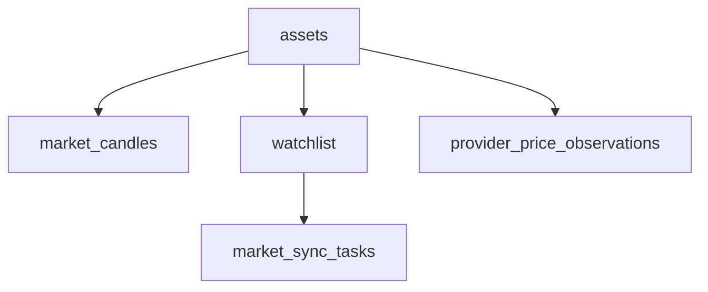
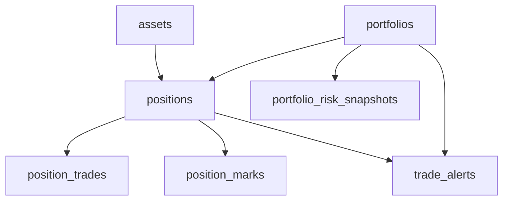
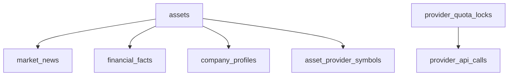
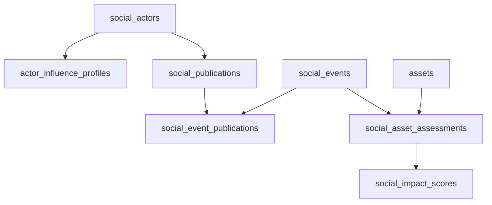
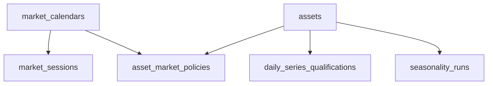
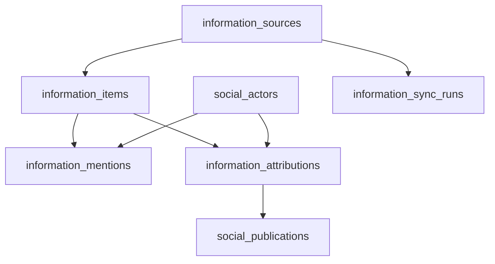
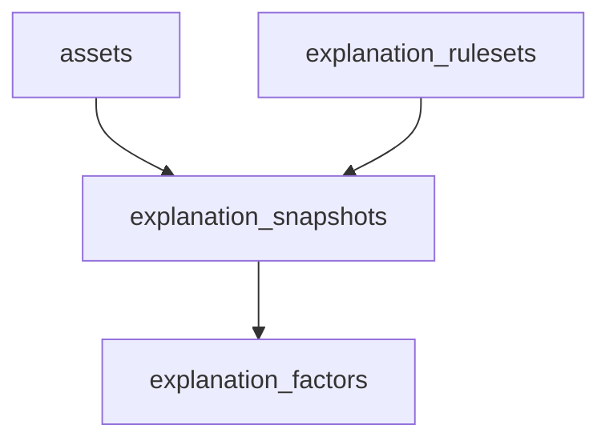

> État courant V11 du 21 novembre 2026 : **48 tables métier et 410 colonnes**, hors Flyway. L’extension informations V9 à V11 et ses colonnes sont décrites en fin de document ; les sections V8 conservent le détail du socle antérieur.

# Base de données Bourse AI

Schéma réel après application de Flyway V1 à V8 sur PostgreSQL 17.7, le 20 novembre 2026. Les 42 tables et 357 colonnes ci-dessous sont extraites de cette base de test ; leur rôle correspond au code livré. Le document d’analyse version 1.2 accompagne cette livraison.

## Données de marché

Un actif possède plusieurs bougies. Les observations par fournisseur conservent leur provenance ; la série canonique est celle utilisée pour les calculs. La liste de suivi crée des tâches d’import pour chaque intervalle, sans recopier les caractéristiques de l’actif.

## Portefeuille et suivi

Une position décrit ce qui reste détenu. Les achats et ventes sont conservés séparément dans le journal, tandis que la dernière valorisation sert au calcul du risque. Une vente ne supprime jamais ses pertes réalisées du portefeuille.

## Informations et quotas

Les tables existantes V1 à V5 sont conservées. V6 ajoute le suivi, les positions et les alertes, ainsi qu’un verrou technique de capacité. V7 ajoute neuf tables pour les publications sociales, les événements, leurs scores et le plafond de collecte X. Aucun mot de passe ni token fournisseur n’est stocké dans ces tables.

## Conventions

- Les prix et sommes utilisent des types décimaux, jamais des nombres flottants binaires.
- Les horodatages sont stockés comme instants UTC ; les horaires de marché utilisent un fuseau IANA distinct.
- `base` désigne la devise du portefeuille ; `quote` la devise de cotation de l’actif.
- Les colonnes d’audit décrivent le stockage ; elles ne remplacent pas la date de marché, de publication ou d’exécution.
- La colonne « obligatoire » indique la contrainte NOT NULL. Les clés et contraintes composées sont précisées sous chaque table.
- Aucun DELETE en cascade n’est défini pour les journaux financiers. Les corrections d’exécutions passées et les dépôts/retraits après création restent à développer.

## Dictionnaire des colonnes

### assets

Référentiel commun des actions et cryptomonnaies.

| Colonne | Type PostgreSQL | Obligatoire | Signification |
|---|---|---|---|
| `id` | `bigint` | Oui | Clé primaire de l’actif ; utilisée par prix, actualités, suivi et positions. |
| `symbol` | `character varying(40)` | Oui | Identifiant interne unique ; un code de place dans le symbole évite les collisions. |
| `name` | `character varying(255)` | Oui | Nom lisible affiché à l’utilisateur. |
| `asset_type` | `character varying(16)` | Oui | STOCK ou CRYPTO ; aucun type FOREX de portefeuille dans ce lot. |
| `currency` | `character varying(3)` | Oui | Devise de cotation à trois lettres, à distinguer de la devise du portefeuille. |
| `created_time` | `timestamp with time zone` | Oui | Date technique de création de l’enregistrement, en UTC. |
| `updated_time` | `timestamp with time zone` | Oui | Date de dernière modification écrite par le service ; aucun trigger global automatique. |

Clé primaire `id`, unicité de `symbol`. Deux titres homonymes de places différentes doivent recevoir des symboles internes distincts.

### market_candles

Séries OHLCV canoniques utilisées par les indicateurs et les graphiques.

| Colonne | Type PostgreSQL | Obligatoire | Signification |
|---|---|---|---|
| `id` | `bigint` | Oui | Identifiant technique généré par la base, sauf pour les tables de verrou. |
| `asset_id` | `bigint` | Oui | Référence vers assets.id ; identifie l’instrument sans répéter ses caractéristiques. |
| `timeframe` | `character varying(8)` | Oui | Durée de bougie : 1m, 15m, 30m, 1h ou 1d selon la route. |
| `open_time` | `timestamp with time zone` | Oui | Début de la bougie en UTC ; distinct de sa date de réception. |
| `open_price` | `numeric(24,10)` | Oui | Prix d’ouverture dans la devise de cotation. |
| `high_price` | `numeric(24,10)` | Oui | Prix le plus haut de la bougie dans la devise de cotation. |
| `low_price` | `numeric(24,10)` | Oui | Prix le plus bas de la bougie dans la devise de cotation. |
| `close_price` | `numeric(24,10)` | Oui | Prix de clôture de la bougie dans la devise de cotation. |
| `volume` | `numeric(28,8)` | Oui | Volume déclaré par la source ; ne pas remplacer une donnée absente par zéro. |
| `provider` | `character varying(64)` | Oui | Nom du fournisseur ou de la provenance technique. |
| `created_time` | `timestamp with time zone` | Oui | Date technique de création de l’enregistrement, en UTC. |
| `updated_time` | `timestamp with time zone` | Oui | Date de dernière modification écrite par le service ; aucun trigger global automatique. |

Unicité `(asset_id, timeframe, open_time)`. Contrôles SQL des prix positifs et OHLC cohérents. Un réimport ignore les bougies déjà présentes ; la correction des historiques reste à implémenter.

### watchlist

Actifs à suivre, symboles Twelve Data et horaires réguliers de séance.

| Colonne | Type PostgreSQL | Obligatoire | Signification |
|---|---|---|---|
| `asset_id` | `bigint` | Oui | Référence vers assets.id ; identifie l’instrument sans répéter ses caractéristiques. |
| `provider_symbol` | `character varying(80)` | Oui | Symbole compris par ce fournisseur ; peut différer du symbole interne. |
| `region` | `character varying(12)` | Oui | US, EU ou GLOBAL ; information de couverture, pas un score financier. |
| `market_zone` | `character varying(80)` | Oui | Fuseau IANA de la séance, par exemple America/New_York ; gère les changements d’heure. |
| `session_open` | `character varying(5)` | Oui | Début de la séance régulière au format HH:mm, heure locale du marché. |
| `session_close` | `character varying(5)` | Oui | Fin exclusive de la séance régulière ; non utilisée pour les cryptos. |
| `enabled` | `boolean` | Oui | Active ou désactive la production de tâches pour cet actif. |
| `created_time` | `timestamp with time zone` | Oui | Date technique de création de l’enregistrement, en UTC. |
| `updated_time` | `timestamp with time zone` | Oui | Date de dernière modification écrite par le service ; aucun trigger global automatique. |

Clé primaire `asset_id`. Plafonds applicatifs : 100 actions actives et 30 cryptos actives. L’ordonnanceur consulte maintenant les séances de market_sessions : fériés et clôtures anticipées inclus pour les calendriers importés et le calendrier US fourni.

### market_sync_tasks

File persistante de synchronisation avec états, tentatives et bail de reprise.

| Colonne | Type PostgreSQL | Obligatoire | Signification |
|---|---|---|---|
| `id` | `bigint` | Oui | Identifiant technique généré par la base, sauf pour les tables de verrou. |
| `asset_id` | `bigint` | Oui | Référence vers assets.id ; identifie l’instrument sans répéter ses caractéristiques. |
| `timeframe` | `character varying(8)` | Oui | Durée de bougie : 1m, 15m, 30m, 1h ou 1d selon la route. |
| `slot_time` | `timestamp with time zone` | Oui | Créneau UTC d’import ; sert avec actif et intervalle à dédupliquer la tâche. |
| `status` | `character varying(20)` | Oui | État métier ou technique, dont les valeurs sont précisées sous la table. |
| `attempts` | `integer` | Oui | Nombre de prises en charge, y compris celles ensuite différées par quota. |
| `next_attempt_at` | `timestamp with time zone` | Oui | Instant minimal pour une prochaine tentative. |
| `lease_until` | `timestamp with time zone` | Non | Expiration du bail de traitement, qui permet la reprise après interruption. |
| `error_code` | `character varying(80)` | Non | Code local assaini, par exemple LOCAL_QUOTA ou HTTP_502. |
| `imported_count` | `integer` | Oui | Nombre de bougies nouvelles lors de la dernière exécution réussie. |
| `created_time` | `timestamp with time zone` | Oui | Date technique de création de l’enregistrement, en UTC. |
| `updated_time` | `timestamp with time zone` | Oui | Date de dernière modification écrite par le service ; aucun trigger global automatique. |

États : PENDING, RUNNING, DEFERRED, SUCCEEDED, FAILED. Unicité `(asset_id, timeframe, slot_time)`. Le bail est un mécanisme de reprise ; la déduplication finale des bougies reste nécessaire.

### portfolios

Capital initial, devise de référence et limite de perte globale.

| Colonne | Type PostgreSQL | Obligatoire | Signification |
|---|---|---|---|
| `id` | `bigint` | Oui | Identifiant technique généré par la base, sauf pour les tables de verrou. |
| `name` | `character varying(120)` | Oui | Nom lisible affiché à l’utilisateur. |
| `base_currency` | `character varying(3)` | Oui | Devise commune utilisée pour le capital, la trésorerie et les limites. |
| `initial_capital` | `numeric(24,8)` | Oui | Capital de référence initial ; les dépôts/retraits ultérieurs ne sont pas encore modélisés. |
| `max_loss_amount` | `numeric(24,8)` | Oui | Perte nette maximale de référence en devise de base ; ce n’est pas une garantie d’exécution. |
| `risk_latched` | `boolean` | Oui | Mémorise une alerte de perte déjà émise ; réarmé après retour à un état sain. |
| `created_time` | `timestamp with time zone` | Oui | Date technique de création de l’enregistrement, en UTC. |
| `updated_time` | `timestamp with time zone` | Oui | Date de dernière modification écrite par le service ; aucun trigger global automatique. |

Le budget est global et exprimé en devise de base. La référence est le capital initial, pas le plus haut historique atteint.

### positions

Quantités restantes et coût de revient d’une position déclarée.

| Colonne | Type PostgreSQL | Obligatoire | Signification |
|---|---|---|---|
| `id` | `bigint` | Oui | Identifiant technique généré par la base, sauf pour les tables de verrou. |
| `portfolio_id` | `bigint` | Oui | Référence vers portfolios.id ; rattache la donnée au portefeuille. |
| `asset_id` | `bigint` | Oui | Référence vers assets.id ; identifie l’instrument sans répéter ses caractéristiques. |
| `quantity` | `numeric(28,8)` | Oui | Nombre de titres ou unités de crypto ; fractions possibles sur huit décimales. |
| `average_entry_quote` | `numeric(24,10)` | Oui | Moyenne pondérée des prix d’achat, hors frais, dans la devise de l’actif. |
| `remaining_cost_base` | `numeric(24,8)` | Oui | Coût de revient des unités restantes en devise de base, frais d’achat inclus. |
| `horizon` | `character varying(12)` | Oui | SHORT, MEDIUM ou LONG ; sélectionne l’unité de temps du signal de révision. |
| `signal_timeframe` | `character varying(8)` | Oui | 15m pour SHORT, 1h pour MEDIUM et 1d pour LONG dans cette version. |
| `opened_at` | `timestamp with time zone` | Oui | Date et heure du premier achat déclaré de cette position. |
| `status` | `character varying(12)` | Oui | État métier ou technique, dont les valeurs sont précisées sous la table. |
| `created_time` | `timestamp with time zone` | Oui | Date technique de création de l’enregistrement, en UTC. |
| `updated_time` | `timestamp with time zone` | Oui | Date de dernière modification écrite par le service ; aucun trigger global automatique. |

États OPEN ou CLOSED. Une quantité nulle clôture la position ; la ligne et son historique sont conservés.

### position_trades

Journal immuable des achats et ventes déclarés, frais, FX et trésorerie.

| Colonne | Type PostgreSQL | Obligatoire | Signification |
|---|---|---|---|
| `id` | `bigint` | Oui | Identifiant technique généré par la base, sauf pour les tables de verrou. |
| `position_id` | `bigint` | Oui | Référence vers positions.id ; peut être absent pour une alerte globale. |
| `portfolio_id` | `bigint` | Oui | Référence vers portfolios.id ; rattache la donnée au portefeuille. |
| `client_order_id` | `character varying(80)` | Oui | Identifiant client stable et unique dans le portefeuille ; évite les doubles saisies réseau. |
| `side` | `character varying(4)` | Oui | BUY ou SELL ; déclaration d’une exécution, aucun ordre transmis au courtier. |
| `quantity` | `numeric(28,8)` | Oui | Nombre de titres ou unités de crypto ; fractions possibles sur huit décimales. |
| `price_quote` | `numeric(24,10)` | Oui | Prix unitaire dans la devise de cotation de l’actif. |
| `fees_quote` | `numeric(24,10)` | Oui | Frais de cette opération dans la devise de cotation ; montant positif ou nul. |
| `fx_to_base` | `numeric(24,10)` | Oui | Valeur d’une unité de devise de cotation dans la devise du portefeuille ; 1 si identiques. |
| `cash_delta_base` | `numeric(24,8)` | Oui | Mouvement de trésorerie net en devise de base ; négatif à l’achat, positif à la vente. |
| `realized_pnl_base` | `numeric(24,8)` | Oui | Résultat réalisé net de la quantité vendue selon le coût moyen ; nul pour un achat. |
| `executed_at` | `timestamp with time zone` | Oui | Instant de l’exécution déclarée ; ne peut pas précéder l’opération précédente. |
| `created_time` | `timestamp with time zone` | Oui | Date technique de création de l’enregistrement, en UTC. |

Unicité `(portfolio_id, client_order_id)`. Les achats sont limités à la trésorerie disponible et les ventes à la quantité détenue ; aucune suppression par cascade des données financières.

### position_marks

Dernier prix et conversion explicites utilisés pour valoriser une position.

| Colonne | Type PostgreSQL | Obligatoire | Signification |
|---|---|---|---|
| `position_id` | `bigint` | Oui | Référence vers positions.id ; peut être absent pour une alerte globale. |
| `price_quote` | `numeric(24,10)` | Oui | Prix unitaire dans la devise de cotation de l’actif. |
| `fx_to_base` | `numeric(24,10)` | Oui | Valeur d’une unité de devise de cotation dans la devise du portefeuille ; 1 si identiques. |
| `observed_at` | `timestamp with time zone` | Oui | Instant du prix de marché utilisé ; ne doit pas être remplacé par l’heure de téléchargement. |
| `source` | `character varying(64)` | Oui | Source ou provenance de la valeur, sans clé API ni URL secrète. |
| `updated_time` | `timestamp with time zone` | Oui | Date de dernière modification écrite par le service ; aucun trigger global automatique. |
| `fx_observed_at` | `timestamp with time zone` | Oui | Instant original du taux de change, distinct du prix ; compatibilité V7 initialisée depuis observed_at. |

Clé primaire `position_id` : une valeur courante par position. Les mises à jour antérieures au dernier prix sont refusées. Le FX reste explicite ; aucune parité EUR/USD implicite.

### portfolio_risk_snapshots

Historique des évaluations de risque et des éventuels manques de données.

| Colonne | Type PostgreSQL | Obligatoire | Signification |
|---|---|---|---|
| `id` | `bigint` | Oui | Identifiant technique généré par la base, sauf pour les tables de verrou. |
| `portfolio_id` | `bigint` | Oui | Référence vers portfolios.id ; rattache la donnée au portefeuille. |
| `evaluated_at` | `timestamp with time zone` | Oui | Instant auquel le calcul de risque a été réalisé. |
| `status` | `character varying(32)` | Oui | État métier ou technique, dont les valeurs sont précisées sous la table. |
| `cash_base` | `numeric(24,8)` | Oui | Capital initial plus mouvements nets de trésorerie. |
| `known_equity_base` | `numeric(24,8)` | Oui | Trésorerie et valeurs connues ; reste partielle si des prix sont absents. |
| `loss_base` | `numeric(24,8)` | Non | Perte nette depuis le capital initial ; NULL si des prix sont absents ou périmés. |
| `missing_marks` | `integer` | Oui | Nombre de positions ouvertes sans valorisation. |
| `stale_marks` | `integer` | Oui | Nombre de valorisations qui ne couvrent pas la dernière observation attendue ou dont le taux FX est inutilisable. |
| `created_time` | `timestamp with time zone` | Oui | Date technique de création de l’enregistrement, en UTC. |

États : OK, DATA_INCOMPLETE, STALE_DATA, CALENDAR_UNKNOWN, MARKET_HALTED, FX_STALE, MARKET_CLOSED_ESTIMATE, OPENING_REFERENCE_ESTIMATE ou LOSS_LIMIT_REACHED. Une perte NULL ne signifie jamais zéro perte.

### trade_alerts

Avis de révision ou alerte globale, conservés jusqu’à consultation et acquittement.

| Colonne | Type PostgreSQL | Obligatoire | Signification |
|---|---|---|---|
| `id` | `bigint` | Oui | Identifiant technique généré par la base, sauf pour les tables de verrou. |
| `portfolio_id` | `bigint` | Oui | Référence vers portfolios.id ; rattache la donnée au portefeuille. |
| `position_id` | `bigint` | Non | Référence vers positions.id ; peut être absent pour une alerte globale. |
| `event_key` | `character varying(180)` | Oui | Clé unique de dédoublonnage de l’événement ou de l’épisode de dépassement. |
| `alert_type` | `character varying(40)` | Oui | LOSS_LIMIT, MACD_REVIEW, SOCIAL_EVENT_REVIEW ou SOCIAL_EVENT_CORRECTION. |
| `message` | `character varying(1500)` | Oui | Motif explicatif destiné à l’interface ; n’exécute pas de vente. |
| `data_time` | `timestamp with time zone` | Oui | Date des données qui ont déclenché l’avis. |
| `status` | `character varying(20)` | Oui | État métier ou technique, dont les valeurs sont précisées sous la table. |
| `created_time` | `timestamp with time zone` | Oui | Date technique de création de l’enregistrement, en UTC. |
| `updated_time` | `timestamp with time zone` | Oui | Date de dernière modification écrite par le service ; aucun trigger global automatique. |

États NEW ou ACKNOWLEDGED. Les alertes restent consultables par l’API ; l’envoi push Android n’est pas encore connecté.

### market_news

Titres et liens d’actualités associés aux actifs, avec leur sentiment simple.

| Colonne | Type PostgreSQL | Obligatoire | Signification |
|---|---|---|---|
| `id` | `bigint` | Oui | Identifiant technique généré par la base, sauf pour les tables de verrou. |
| `asset_id` | `bigint` | Oui | Référence vers assets.id ; identifie l’instrument sans répéter ses caractéristiques. |
| `source` | `character varying(120)` | Oui | Source ou provenance de la valeur, sans clé API ni URL secrète. |
| `title` | `character varying(1500)` | Oui | Titre de l’article ; le texte complet n’est pas conservé par ce connecteur. |
| `url` | `character varying(2000)` | Oui | Lien de l’article ; unique pour un actif donné. |
| `published_time` | `timestamp with time zone` | Non | Date de publication disponible chez la source, éventuellement absente. |
| `seen_time` | `timestamp with time zone` | Oui | Date technique de première collecte ; ne remplace pas la date de publication. |
| `sentiment_score` | `integer` | Non | -1, 0 ou +1 selon les mots clés reconnus dans le titre. |
| `sentiment_method` | `character varying(64)` | Non | Version de méthode, actuellement KEYWORDS_V1 après analyse. |
| `created_time` | `timestamp with time zone` | Oui | Date technique de création de l’enregistrement, en UTC. |
| `updated_time` | `timestamp with time zone` | Oui | Date de dernière modification écrite par le service ; aucun trigger global automatique. |
| `source_country` | `character varying(10)` | Non | Pays déclaré par la source, tronqué à la taille existante du champ. |
| `language` | `character varying(20)` | Non | Langue annoncée par le fournisseur. |
| `region_tag` | `character varying(20)` | Non | Champ prévu pour le classement régional, pas automatiquement renseigné aujourd’hui. |

Unicité `(asset_id, url)`. La date GDELT publiée est conservée lorsqu’elle existe.

### financial_facts

Faits comptables SEC avec période, unité et dépôt source.

| Colonne | Type PostgreSQL | Obligatoire | Signification |
|---|---|---|---|
| `id` | `bigint` | Oui | Identifiant technique généré par la base, sauf pour les tables de verrou. |
| `asset_id` | `bigint` | Oui | Référence vers assets.id ; identifie l’instrument sans répéter ses caractéristiques. |
| `concept` | `character varying(120)` | Oui | Concept comptable SEC, par exemple revenu ou bénéfice. |
| `value` | `numeric(30,4)` | Oui | Valeur du concept dans l’unité indiquée ; ce n’est pas nécessairement une somme monétaire. |
| `unit` | `character varying(24)` | Oui | Unité déclarée, par exemple USD ou shares. |
| `period_start` | `date` | Non | Début de la période comptable, si pertinent. |
| `period_end` | `date` | Oui | Fin de la période comptable mesurée. |
| `filed_date` | `date` | Oui | Date de dépôt du document ; importante pour éviter l’anticipation en backtest. |
| `form_type` | `character varying(20)` | Oui | Type de dépôt, par exemple 10-K ou 10-Q. |
| `accession_number` | `character varying(32)` | Oui | Identifiant du dépôt SEC source ; distingue les versions déclarées. |
| `source` | `character varying(40)` | Oui | Source ou provenance de la valeur, sans clé API ni URL secrète. |
| `created_time` | `timestamp with time zone` | Oui | Date technique de création de l’enregistrement, en UTC. |
| `updated_time` | `timestamp with time zone` | Oui | Date de dernière modification écrite par le service ; aucun trigger global automatique. |

Unicité `(asset_id, concept, accession_number, period_end, unit)` pour distinguer les dépôts et unités.

### company_profiles

Profil descriptif de chaque société, distinct des comptes financiers.

| Colonne | Type PostgreSQL | Obligatoire | Signification |
|---|---|---|---|
| `asset_id` | `bigint` | Oui | Référence vers assets.id ; identifie l’instrument sans répéter ses caractéristiques. |
| `company_name` | `character varying(255)` | Non | Nom de société communiqué par la source. |
| `exchange_name` | `character varying(120)` | Non | Nom de la place communiqué par la source. |
| `sector` | `character varying(120)` | Non | Secteur d’activité déclaré. |
| `industry` | `character varying(200)` | Non | Sous-secteur ou industrie déclarée. |
| `website` | `character varying(500)` | Non | Site de la société. |
| `market_cap` | `numeric(30,2)` | Non | Capitalisation communiquée par la source ; unité et date à contrôler avant comparaison. |
| `source` | `character varying(40)` | Oui | Source ou provenance de la valeur, sans clé API ni URL secrète. |
| `fetched_time` | `timestamp with time zone` | Oui | Date de récupération de ce profil. |
| `created_time` | `timestamp with time zone` | Oui | Date technique de création de l’enregistrement, en UTC. |
| `updated_time` | `timestamp with time zone` | Oui | Date de dernière modification écrite par le service ; aucun trigger global automatique. |

Clé primaire `asset_id` : au plus un profil courant par actif.

### asset_provider_symbols

Correspondance entre identifiant interne et symbole de chaque fournisseur.

| Colonne | Type PostgreSQL | Obligatoire | Signification |
|---|---|---|---|
| `asset_id` | `bigint` | Oui | Référence vers assets.id ; identifie l’instrument sans répéter ses caractéristiques. |
| `provider` | `character varying(40)` | Oui | Nom du fournisseur ou de la provenance technique. |
| `provider_symbol` | `character varying(80)` | Oui | Symbole compris par ce fournisseur ; peut différer du symbole interne. |
| `exchange_mic` | `character varying(12)` | Non | Identifiant de place MIC quand disponible ; champ facultatif. |
| `created_time` | `timestamp with time zone` | Oui | Date technique de création de l’enregistrement, en UTC. |
| `updated_time` | `timestamp with time zone` | Oui | Date de dernière modification écrite par le service ; aucun trigger global automatique. |

Clé primaire composée `(asset_id, provider)`.

### provider_price_observations

Observations distinctes par fournisseur pour la provenance et la comparaison.

| Colonne | Type PostgreSQL | Obligatoire | Signification |
|---|---|---|---|
| `id` | `bigint` | Oui | Identifiant technique généré par la base, sauf pour les tables de verrou. |
| `asset_id` | `bigint` | Oui | Référence vers assets.id ; identifie l’instrument sans répéter ses caractéristiques. |
| `provider` | `character varying(40)` | Oui | Nom du fournisseur ou de la provenance technique. |
| `provider_symbol` | `character varying(80)` | Oui | Symbole compris par ce fournisseur ; peut différer du symbole interne. |
| `timeframe` | `character varying(8)` | Oui | Durée de bougie : 1m, 15m, 30m, 1h ou 1d selon la route. |
| `open_time` | `timestamp with time zone` | Oui | Début de la bougie en UTC ; distinct de sa date de réception. |
| `open_price` | `numeric(24,10)` | Oui | Prix d’ouverture dans la devise de cotation. |
| `high_price` | `numeric(24,10)` | Oui | Prix le plus haut de la bougie dans la devise de cotation. |
| `low_price` | `numeric(24,10)` | Oui | Prix le plus bas de la bougie dans la devise de cotation. |
| `close_price` | `numeric(24,10)` | Oui | Prix de clôture de la bougie dans la devise de cotation. |
| `volume` | `numeric(28,8)` | Oui | Volume déclaré par la source ; ne pas remplacer une donnée absente par zéro. |
| `currency` | `character varying(3)` | Oui | Devise de cotation à trois lettres, à distinguer de la devise du portefeuille. |
| `price_adjustment` | `character varying(30)` | Oui | Convention d’ajustement ; UNSPECIFIED tant qu’elle n’a pas été qualifiée. |
| `created_time` | `timestamp with time zone` | Oui | Date technique de création de l’enregistrement, en UTC. |
| `updated_time` | `timestamp with time zone` | Oui | Date de dernière modification écrite par le service ; aucun trigger global automatique. |

Unicité `(asset_id, provider, timeframe, open_time)` ; les alternatives ne sont pas mélangées silencieusement dans la série canonique.

### import_jobs

Journal des tentatives d’import par fournisseur et jeu de données.

| Colonne | Type PostgreSQL | Obligatoire | Signification |
|---|---|---|---|
| `id` | `bigint` | Oui | Identifiant technique généré par la base, sauf pour les tables de verrou. |
| `asset_symbol` | `character varying(40)` | Oui | Symbole demandé, conservé même si la création de l’actif échoue. |
| `provider` | `character varying(50)` | Oui | Nom du fournisseur ou de la provenance technique. |
| `dataset` | `character varying(50)` | Oui | Jeu de données ou intervalle demandé, par exemple DAILY_OHLCV ou 15m_OHLCV. |
| `status` | `character varying(20)` | Oui | État métier ou technique, dont les valeurs sont précisées sous la table. |
| `imported_count` | `integer` | Oui | Nombre d’enregistrements importés par cette tentative. |
| `error_message` | `character varying(1000)` | Non | Erreur assainie ou code technique ; aucune clé, URL signée ou réponse distante. |
| `started_time` | `timestamp with time zone` | Oui | Début de la tentative d’import. |
| `finished_time` | `timestamp with time zone` | Non | Fin de la tentative, absente si elle n’a pas encore été terminée. |
| `created_time` | `timestamp with time zone` | Oui | Date technique de création de l’enregistrement, en UTC. |
| `updated_time` | `timestamp with time zone` | Oui | Date de dernière modification écrite par le service ; aucun trigger global automatique. |

Les états et erreurs suivent les services d’import. Les quotas et leurs réservations ne sont pas annulés si l’import échoue.

### provider_quota_locks

Verrou et pause d’un fournisseur, partagés entre instances de l’application.

| Colonne | Type PostgreSQL | Obligatoire | Signification |
|---|---|---|---|
| `provider` | `character varying(40)` | Oui | Nom du fournisseur ou de la provenance technique. |
| `blocked_until` | `timestamp with time zone` | Non | Fin d’une pause imposée après une limite fournisseur. |
| `created_time` | `timestamp with time zone` | Oui | Date technique de création de l’enregistrement, en UTC. |
| `updated_time` | `timestamp with time zone` | Oui | Date de dernière modification écrite par le service ; aucun trigger global automatique. |

Clé primaire `provider`. Le verrou SQL assure une réservation cohérente entre instances partageant la base.

### provider_api_calls

Réservations de crédits, conservées même si l’appel distant échoue.

| Colonne | Type PostgreSQL | Obligatoire | Signification |
|---|---|---|---|
| `id` | `bigint` | Oui | Identifiant technique généré par la base, sauf pour les tables de verrou. |
| `provider` | `character varying(40)` | Oui | Nom du fournisseur ou de la provenance technique. |
| `reserved_at` | `timestamp with time zone` | Oui | Instant de réservation du crédit dans les fenêtres de quota. |
| `credits` | `integer` | Oui | Nombre de crédits réservés ; les opérations actuelles de ce lot coûtent un crédit local par requête. |
| `created_time` | `timestamp with time zone` | Oui | Date technique de création de l’enregistrement, en UTC. |

Index `(provider, reserved_at)` pour compter les crédits des fenêtres 60 secondes et 24 heures.

### watchlist_guard

Verrou technique unique qui sérialise les modifications et créations de tâches.

| Colonne | Type PostgreSQL | Obligatoire | Signification |
|---|---|---|---|
| `id` | `integer` | Oui | Ligne de verrou unique, valeur 1 ; aucune donnée financière. |

## Publications sociales et événements (V7)

Une même annonce reçoit une évaluation par actif. Les notes historiques conservent leurs entrées ; le texte original et la date de collecte permettent de distinguer publication et disponibilité réelle. Le fonctionnement, les limites et les exemples d’API sont détaillés dans [SOCIAL_SIGNALS.md](SOCIAL_SIGNALS.md).

### social_actors

Compte suivi d’une personne ou d’une organisation. Un même acteur sur deux réseaux utilise deux lignes dans ce prototype.

| Colonne | Type PostgreSQL | Obligatoire | Signification |
|---|---|---|---|
| `id` | `bigint` | Oui | Identifiant interne du compte suivi. |
| `display_name` | `character varying(160)` | Oui | Nom affiché, configuré manuellement. |
| `role_label` | `character varying(160)` | Oui | Fonction ou rôle descriptif ; l’autorité historique est précisée dans les profils. |
| `platform` | `character varying(24)` | Oui | X, TRUTH_SOCIAL, LINKEDIN, YOUTUBE, OFFICIAL_WEB ou OTHER ; seul X possède un collecteur automatique. |
| `account_id` | `character varying(100)` | Oui | Identifiant du compte sur la plateforme ; numérique sur X. |
| `identity_confirmed` | `boolean` | Oui | Identité déclarée vérifiée par une personne ; faux par défaut. |
| `identity_evidence_url` | `character varying(1500)` | Non | URL HTTPS justifiant l’identité ; obligatoire si identité confirmée. |
| `last_post_id` | `character varying(24)` | Non | Plus grand identifiant X complètement parcouru ; curseur since_id. |
| `pending_page_token` | `character varying(2000)` | Non | Jeton de pagination du parcours en cours ; absent après la dernière page. |
| `pending_high_water_id` | `character varying(24)` | Non | Plus grand identifiant rencontré pendant le parcours ; ne devient last_post_id qu’à la fin. |
| `last_sync_at` | `timestamp with time zone` | Non | Dernière page collectée avec succès. |
| `created_time` | `timestamp with time zone` | Oui | Instant de création de la ligne en base. |
| `updated_time` | `timestamp with time zone` | Oui | Instant de dernière modification de la ligne en base. |

Unicité (platform, account_id). Aucune clé API stockée. Les états des curseurs sont modifiés sous verrou du compte.

### actor_influence_profiles

Autorité de l’auteur sur un sujet, applicable pendant une période définie.

| Colonne | Type PostgreSQL | Obligatoire | Signification |
|---|---|---|---|
| `id` | `bigint` | Oui | Identifiant du profil. |
| `actor_id` | `bigint` | Oui | Clé étrangère vers social_actors. |
| `topic` | `character varying(30)` | Oui | TARIFFS, MONETARY_POLICY, CORPORATE, CRYPTO ou GENERAL. |
| `authority_score` | `integer` | Oui | Influence configurée entre 0 et 100 ; ce n’est pas une mesure automatique de compétence. |
| `valid_from` | `timestamp with time zone` | Oui | Début inclus de la période d’autorité. |
| `valid_until` | `timestamp with time zone` | Non | Fin exclue, facultative ; doit être postérieure au début. |
| `rationale` | `character varying(1500)` | Oui | Justification humaine du niveau et de la période. |
| `created_time` | `timestamp with time zone` | Oui | Instant de création de la ligne en base. |

Le service refuse les périodes qui se chevauchent pour le même acteur et le même sujet, sous verrou de l’acteur. Pas de repli automatique vers GENERAL.

### social_publications

Publications collectées ou ingérées ; texte d’origine conservé.

| Colonne | Type PostgreSQL | Obligatoire | Signification |
|---|---|---|---|
| `id` | `bigint` | Oui | Identifiant interne de la publication. |
| `actor_id` | `bigint` | Oui | Clé étrangère vers le compte suivi. |
| `external_id` | `character varying(100)` | Oui | Identifiant stable de la publication sur sa plateforme. |
| `content` | `text` | Oui | Texte source, jusqu’à 30 000 caractères via le service ; aucun audio ou média traité. |
| `source_url` | `character varying(1500)` | Oui | Lien HTTPS vers l’original. |
| `published_at` | `timestamp with time zone` | Oui | Instant de publication déclaré par la source ; ne peut pas être futur à l’ingestion. |
| `collected_at` | `timestamp with time zone` | Oui | Instant réel d’ingestion dans l’application. |
| `retracted` | `boolean` | Oui | Drapeau réservé aux retraits individuels ; l’API de ce lot gère le retrait au niveau événement. |
| `created_time` | `timestamp with time zone` | Oui | Instant de création de la ligne en base. |
| `attribution_kind` | `character varying(32)` | Oui | ORIGINAL_ACCOUNT_POST ou HUMAN_VERIFIED_QUOTE ; distingue publication collectée et parole attribuée manuellement. |

Unicité (actor_id, external_id). Un rejeu identique retourne la ligne existante. Une modification du même identifiant est refusée pour préserver l’original ; une nouvelle version doit utiliser un nouvel identifiant.

### social_events

Événement économique commun à une ou plusieurs publications.

| Colonne | Type PostgreSQL | Obligatoire | Signification |
|---|---|---|---|
| `id` | `bigint` | Oui | Identifiant interne de l’événement. |
| `canonical_key` | `character varying(180)` | Oui | Clé canonique choisie à la classification pour regrouper les reprises. |
| `title` | `character varying(300)` | Oui | Libellé de l’événement. |
| `topic` | `character varying(30)` | Oui | Sujet utilisé pour sélectionner les profils d’autorité. |
| `event_kind` | `character varying(24)` | Oui | ANNOUNCEMENT, RUMOR, ENACTED, OPINION ou RETRACTION. |
| `confirmation` | `character varying(24)` | Oui | UNCONFIRMED, AUTHOR_STATEMENT, CORROBORATED ou OFFICIAL_DOCUMENT ; validation manuelle. |
| `evidence_url` | `character varying(1500)` | Oui | URL HTTPS de la preuve ou source de confirmation. |
| `retracted` | `boolean` | Oui | Vrai si l’événement est retiré : impact et confiance recalculés à zéro. |
| `revision` | `integer` | Oui | Version de l’événement ; augmente à la révision et au rattachement d’une nouvelle source. |
| `created_time` | `timestamp with time zone` | Oui | Instant de création de la ligne en base. |
| `updated_time` | `timestamp with time zone` | Oui | Instant de dernière modification de la ligne en base. |

Unicité canonical_key. Une reprise doit être explicitement rattachée au bon événement ; aucun regroupement sémantique automatique n’est encore effectué. La version et ses entrées sont conservées dans chaque score.

### social_event_publications

Association entre événements et publications, sans recopier le texte.

| Colonne | Type PostgreSQL | Obligatoire | Signification |
|---|---|---|---|
| `event_id` | `bigint` | Oui | Clé étrangère vers social_events. |
| `publication_id` | `bigint` | Oui | Clé étrangère vers social_publications. |

Clé primaire composée (event_id, publication_id). Une publication peut concerner plusieurs événements ; une reprise ne crée pas un nouvel événement automatiquement.

### social_asset_assessments

Interprétation économique courante d’un événement pour un actif précis.

| Colonne | Type PostgreSQL | Obligatoire | Signification |
|---|---|---|---|
| `id` | `bigint` | Oui | Identifiant de l’évaluation. |
| `event_id` | `bigint` | Oui | Clé étrangère vers social_events. |
| `asset_id` | `bigint` | Oui | Clé étrangère vers assets ; action ou crypto. |
| `direction` | `character varying(12)` | Oui | POSITIVE, NEGATIVE, MIXED ou UNKNOWN ; hypothèse explicitée. |
| `materiality` | `integer` | Oui | Importance économique estimée de 0 à 100. |
| `relevance` | `integer` | Oui | Exposition de l’actif à l’événement, de 0 à 100. |
| `novelty` | `integer` | Oui | Nouveauté estimée, de 0 à 100. |
| `analyst_confidence` | `integer` | Oui | Confiance d’entrée de 0 à 100, plafonnée par identité et confirmation au calcul. |
| `horizon` | `character varying(12)` | Oui | INTRADAY, DAYS, MONTHS ou YEARS : horizon de l’effet, pas de vente obligatoire. |
| `rationale` | `character varying(2000)` | Oui | Justification de l’exposition et du sens ; saisie structurée manuelle. |
| `assessed_at` | `timestamp with time zone` | Oui | Instant de la dernière classification de cet actif. |

Unicité (event_id, asset_id). Une mise à jour remplace l’évaluation courante, mais chaque calcul en conserve une copie dans son instantané d’audit.

### social_impact_scores

Historique des calculs explicables par événement et actif.

| Colonne | Type PostgreSQL | Obligatoire | Signification |
|---|---|---|---|
| `id` | `bigint` | Oui | Identifiant unique du calcul. |
| `assessment_id` | `bigint` | Oui | Clé étrangère vers l’évaluation de l’actif. |
| `event_revision` | `integer` | Oui | Version de l’événement utilisée lors du calcul. |
| `scored_at` | `timestamp with time zone` | Oui | Instant auquel le score était réellement disponible ; référence de disponibilité en backtest. |
| `authority_score` | `integer` | Oui | Maximum des autorités applicables au sujet et à la date des publications actives. |
| `potential_impact` | `numeric(8,4)` | Oui | Impact non signé de 0 à 100 après exposition et décroissance temporelle. |
| `confidence_score` | `integer` | Oui | Confiance plafonnée de 0 à 95 dans ce modèle ; pas une probabilité calibrée. |
| `signed_score` | `numeric(8,4)` | Non | Impact signé multiplié par confiance/100 ; NULL si sens MIXED ou UNKNOWN. |
| `method` | `character varying(48)` | Oui | Version du modèle : SOCIAL_EVENT_V1_HEURISTIC. |
| `input_snapshot` | `text` | Oui | JSON texte des entrées, preuves, profils, dates, rôle, justification et coefficients ; clés SQL normalisées. |
| `review_only` | `boolean` | Oui | Vrai dans ce lot ; aucune exécution courtier. |

Plusieurs calculs sont conservés par évaluation. Ne pas les sommer : le dernier id représente la dernière photographie. Les reprises n’additionnent pas l’autorité. Le recalcul temporel est explicite, sans planification sociale.

### social_api_guard

Verrou singleton sérialisant les réservations de lectures X.

| Colonne | Type PostgreSQL | Obligatoire | Signification |
|---|---|---|---|
| `id` | `integer` | Oui | Clé primaire singleton égale à 1. |

SELECT FOR UPDATE avant le comptage et la réservation. Le verrou est partagé par les instances qui utilisent la même base.

### social_api_reservations

Réservations conservatrices du plafond de collecte X, persistantes même en cas d’échec réseau.

| Colonne | Type PostgreSQL | Obligatoire | Signification |
|---|---|---|---|
| `id` | `bigint` | Oui | Identifiant de la tentative réservée. |
| `actor_id` | `bigint` | Oui | Clé étrangère vers le compte X ciblé. |
| `month_key` | `character varying(7)` | Oui | Mois civil UTC au format YYYY-MM ; indépendant du cycle de facturation fournisseur. |
| `reserved_posts` | `integer` | Oui | Cinq lectures réservées par tentative, avant tout appel HTTP. |
| `fetched_posts` | `integer` | Non | Nombre de publications dans la page réussie ; NULL si l’appel ou la page a échoué. |
| `reserved_at` | `timestamp with time zone` | Oui | Instant de réservation dans une transaction indépendante. |

Somme reserved_posts du mois comparée à SOCIAL_X_MONTHLY_POST_LIMIT. Les réservations ne sont pas remboursées sur une page vide ou un échec ; ce compteur ne garantit pas une facture maximale en euros.

## Calendriers informations saisonnalité et explications V8

Les règles, les prix, les nouvelles et la disponibilité des données restent distingués. Aucun score ne constitue un ordre exécutable. Le [guide local](BACKEND_LOCAL.md) détaille les API et les états.

### market_calendars

Couverture vérifiée et fuseau d’un calendrier de séances régulières.

| Colonne | Type PostgreSQL | Obligatoire | Signification |
|---|---|---|---|
| `code` | `character varying(40)` | Oui | Identifiant stable de configuration. |
| `zone_id` | `character varying(80)` | Oui | Fuseau IANA, par exemple America/New_York. |
| `coverage_start` | `date` | Oui | Première date locale couverte. |
| `coverage_end` | `date` | Oui | Dernière date locale couverte. |
| `source_url` | `character varying(1500)` | Oui | URL publique de provenance ; aucune clé API. |
| `updated_time` | `timestamp with time zone` | Oui | Instant de dernière modification en base. |

Clé primaire code. Le calendrier US fourni couvre 2026–2028 ; hors couverture, aucun jour ouvert/fermé n’est inventé.

### market_sessions

Une ligne par date couverte, y compris les jours fermés.

| Colonne | Type PostgreSQL | Obligatoire | Signification |
|---|---|---|---|
| `calendar_code` | `character varying(40)` | Oui | Clé étrangère vers market_calendars. |
| `session_date` | `date` | Oui | Date locale du marché. |
| `opens_at` | `timestamp with time zone` | Non | Ouverture en UTC ; NULL avec closes_at pour une fermeture. |
| `closes_at` | `timestamp with time zone` | Non | Clôture effective en UTC, y compris clôture anticipée. |
| `reason` | `character varying(120)` | Oui | REGULAR, WEEKEND, OFFICIAL_HOLIDAY, EARLY_CLOSE ou motif validé. |
| `source_url` | `character varying(1500)` | Oui | URL publique de provenance ; aucune clé API. |
| `updated_time` | `timestamp with time zone` | Oui | Instant de dernière modification en base. |

Clé primaire (calendar_code, session_date). Le modèle accepte une séance continue sur sa date locale ; pauses et séances traversant minuit restent hors périmètre.

### asset_market_policies

Affectation d’un actif et règles de livraison, suspension et FX.

| Colonne | Type PostgreSQL | Obligatoire | Signification |
|---|---|---|---|
| `asset_id` | `bigint` | Oui | Clé étrangère vers assets. |
| `calendar_code` | `character varying(40)` | Oui | Calendrier affecté, CRYPTO_24_7 ou UNASSIGNED ; code volontairement sans FK pour les conventions techniques. |
| `delivery_grace_seconds` | `integer` | Oui | Marge de livraison avant d’exiger une bougie ; défaut 180 s. |
| `trading_status` | `character varying(16)` | Oui | ACTIVE ou HALTED, déclaré manuellement. |
| `status_reason` | `character varying(300)` | Non | Motif de la suspension ou du changement de statut. |
| `fx_max_age_seconds` | `integer` | Oui | Durée de validité propre au taux FX ; défaut 3 600 s, ajustée au week-end FX conventionnel. |
| `updated_time` | `timestamp with time zone` | Oui | Instant de dernière modification en base. |

Clé primaire asset_id. L’affectation US par défaut est limitée à la configuration régulière explicite US/New York/09:30–16:00 ; les autres places nécessitent un calendrier.

### daily_series_qualifications

Attestation humaine de la base d’ajustement des séries quotidiennes.

| Colonne | Type PostgreSQL | Obligatoire | Signification |
|---|---|---|---|
| `asset_id` | `bigint` | Oui | Clé étrangère vers assets. |
| `provider` | `character varying(64)` | Oui | Identifiant du fournisseur de cours. |
| `adjustment` | `character varying(32)` | Oui | SPLIT_ADJUSTED ou TOTAL_RETURN ; ne transforme pas les données. |
| `evidence_url` | `character varying(1500)` | Oui | URL HTTPS justifiant la configuration ou la validation humaine. |
| `qualified_at` | `timestamp with time zone` | Oui | Instant de l’attestation ; une analyse antérieure ne la suppose pas connue. |

Clé primaire asset_id. Le fournisseur doit correspondre à celui de toutes les bougies utilisées ; sinon la qualification n’est pas appliquée.

### seasonality_runs

Résultats historiques mensuels, trimestriels et annuels enregistrés.

| Colonne | Type PostgreSQL | Obligatoire | Signification |
|---|---|---|---|
| `id` | `bigint` | Oui | Identifiant interne de la ligne. |
| `asset_id` | `bigint` | Oui | Clé étrangère vers assets. |
| `as_of` | `timestamp with time zone` | Oui | Instant de référence de l’analyse. |
| `computed_at` | `timestamp with time zone` | Oui | Instant réel du calcul. |
| `method` | `character varying(64)` | Oui | Identifiant versionné de la méthode. |
| `input_hash` | `character varying(64)` | Oui | SHA-256 des dates, clôtures et fournisseurs de la série utilisée. |
| `result_json` | `text` | Oui | Résultat complet conservé en JSON texte. |

Snapshots conservés ; statistiques exploratoires, usableForScoring=false. Les périodes incomplètes et les séries présentant de grands trous ne deviennent pas un signal.

### information_sources

Catalogue administrateur des flux publics, activations et reprises.

| Colonne | Type PostgreSQL | Obligatoire | Signification |
|---|---|---|---|
| `code` | `character varying(60)` | Oui | Identifiant stable de configuration. |
| `name` | `character varying(180)` | Oui | Nom lisible de la configuration ou de la source. |
| `feed_url` | `character varying(1500)` | Oui | Adresse HTTPS du RSS/Atom à télécharger, issue d’un catalogue de confiance. |
| `evidence_url` | `character varying(1500)` | Oui | URL HTTPS justifiant la configuration ou la validation humaine. |
| `region` | `character varying(30)` | Oui | Portée géographique indicative. |
| `language_code` | `character varying(12)` | Oui | Langue principale annoncée. |
| `enabled` | `boolean` | Oui | Activation explicite ; false par défaut. |
| `publisher_actor_id` | `bigint` | Non | Clé étrangère vers le compte éditeur institutionnel ou média, pas un locuteur supposé. |
| `etag` | `character varying(1000)` | Non | Validateur HTTP facultatif pour requêtes conditionnelles. |
| `last_modified` | `character varying(1000)` | Non | Dernière valeur HTTP Last-Modified connue. |
| `next_attempt_at` | `timestamp with time zone` | Non | Prochain instant autorisé, incluant intervalle minimal et backoff. |
| `lease_until` | `timestamp with time zone` | Non | Expiration du bail réseau ; la requête est réalisée hors transaction longue. |
| `lease_token` | `character varying(40)` | Non | Identifiant de tentative qui interdit à un ancien worker de publier après reprise ; pas un token fournisseur. |
| `last_success_at` | `timestamp with time zone` | Non | Dernière collecte ou réponse 304 réussie. |
| `last_error` | `character varying(120)` | Non | Code d’échec assaini, sans réponse distante ni clé. |
| `created_time` | `timestamp with time zone` | Oui | Instant de création en base. |
| `updated_time` | `timestamp with time zone` | Oui | Instant de dernière modification en base. |

Clé primaire code. Douze flux fournis, désactivés par défaut. Les sources sont indépendantes du quota de cours et de X. Les URLs ne sont pas acceptées depuis un article ou un appel REST arbitraire.

### information_items

Titres et résumés RSS/Atom, avec révisions et disponibilité.

| Colonne | Type PostgreSQL | Obligatoire | Signification |
|---|---|---|---|
| `id` | `bigint` | Oui | Identifiant interne de la ligne. |
| `source_code` | `character varying(60)` | Oui | Clé étrangère vers information_sources. |
| `external_key` | `character varying(64)` | Oui | SHA-256 du GUID/id ou lien stable fourni par le flux. |
| `content_hash` | `character varying(64)` | Oui | SHA-256 du contenu, URL, date et auteur ; distingue les révisions. |
| `title` | `character varying(1000)` | Oui | Titre collecté. |
| `summary` | `text` | Oui | Résumé textuel nettoyé du balisage ; aucun contournement d’accès à l’article. |
| `original_url` | `character varying(1500)` | Oui | Lien HTTPS original à ouvrir pour vérifier l’information. |
| `author_text` | `character varying(300)` | Non | Champ auteur brut de la source, sans certification du locuteur. |
| `published_at` | `timestamp with time zone` | Non | Date originale de publication, NULL si absente ou illisible. |
| `collected_at` | `timestamp with time zone` | Oui | Date réelle de collecte. |
| `publication_id` | `bigint` | Non | Clé étrangère vers social_publications. |
| `review_status` | `character varying(24)` | Oui | PENDING_REVIEW, DATE_MISSING ou FUTURE_DATE. Une date absente n’est pas remplacée par l’heure de collecte. |

Unicité (source_code, external_key, content_hash). Les versions précédentes restent intactes. publication_id reste NULL si la date est inutilisable.

### information_mentions

Noms de personnes suivies rencontrés dans le texte collecté.

| Colonne | Type PostgreSQL | Obligatoire | Signification |
|---|---|---|---|
| `item_id` | `bigint` | Oui | Clé étrangère vers information_items. |
| `actor_id` | `bigint` | Oui | Clé étrangère vers social_actors. |
| `matched_name` | `character varying(160)` | Oui | Nom exact du compte suivi qui a correspondu au texte. |
| `attribution_status` | `character varying(24)` | Oui | NAME_MATCH_ONLY ou HUMAN_VERIFIED_QUOTE. |
| `evidence` | `character varying(1500)` | Non | Preuve saisie lors d’une attribution humaine. |

Clé primaire (item_id, actor_id). Une correspondance de nom ne prouve jamais que cette personne a prononcé les mots.

### information_attributions

Passages attribués à un acteur après validation humaine explicite.

| Colonne | Type PostgreSQL | Obligatoire | Signification |
|---|---|---|---|
| `id` | `bigint` | Oui | Identifiant interne de la ligne. |
| `item_id` | `bigint` | Oui | Clé étrangère vers information_items. |
| `actor_id` | `bigint` | Oui | Clé étrangère vers social_actors. |
| `quote_hash` | `character varying(64)` | Oui | SHA-256 du passage exact. |
| `exact_quote` | `character varying(2000)` | Oui | Passage de 10 à 2 000 caractères présent dans le texte collecté. |
| `evidence_url` | `character varying(1500)` | Oui | URL HTTPS justifiant la configuration ou la validation humaine. |
| `publication_id` | `bigint` | Oui | Clé étrangère vers social_publications. |
| `verified_at` | `timestamp with time zone` | Oui | Instant où la validation humaine a été déclarée à l’API. |

Unicité (item_id, actor_id, quote_hash). La publication reliée porte HUMAN_VERIFIED_QUOTE et conserve la date et le lien original. Le code contrôle la présence du passage, pas la vérité de l’attribution.

### information_sync_runs

Journal des tentatives de collecte, y compris les reprises.

| Colonne | Type PostgreSQL | Obligatoire | Signification |
|---|---|---|---|
| `id` | `bigint` | Oui | Identifiant interne de la ligne. |
| `source_code` | `character varying(60)` | Oui | Clé étrangère vers information_sources. |
| `started_at` | `timestamp with time zone` | Oui | Début de la tentative. |
| `finished_at` | `timestamp with time zone` | Non | Fin, absente si en cours. |
| `status` | `character varying(24)` | Oui | État explicite du traitement. |
| `inserted_count` | `integer` | Oui | Nombre de nouvelles versions d’articles insérées. |
| `error_code` | `character varying(120)` | Non | Code technique assaini. |

États RUNNING, SUCCEEDED, NOT_MODIFIED, FAILED, ABANDONED ou LEASE_LOST. Une reprise après expiration marque l’ancien traitement abandonné.

### explanation_guard

Verrou technique des versions et snapshots explicatifs.

| Colonne | Type PostgreSQL | Obligatoire | Signification |
|---|---|---|---|
| `id` | `integer` | Oui | Identifiant interne de la ligne. |

Singleton id=1. Les calculs sont sérialisés dans cette première version ; aucun verrou de prix ou de portefeuille n’est requis pour expliquer un score.

### explanation_rulesets

Versions immuables des poids et seuils du score expérimental.

| Colonne | Type PostgreSQL | Obligatoire | Signification |
|---|---|---|---|
| `id` | `bigint` | Oui | Identifiant interne de la ligne. |
| `name` | `character varying(120)` | Oui | Nom lisible de la configuration ou de la source. |
| `method` | `character varying(64)` | Oui | Identifiant versionné de la méthode. |
| `configuration_json` | `text` | Oui | Poids technique/fondamental/information, seuil de variation de marge et seuils RSI. |
| `created_at` | `timestamp with time zone` | Oui | Instant de création de la version. |

Unicité name. Les défauts DAY, MONTH, YEAR sont conservés ; toute expérience crée une nouvelle version. Amplitudes non négatives, somme entre 1 et 50.

### explanation_snapshots

Explication complète et datée d’un score par actif et horizon.

| Colonne | Type PostgreSQL | Obligatoire | Signification |
|---|---|---|---|
| `id` | `bigint` | Oui | Identifiant interne de la ligne. |
| `asset_id` | `bigint` | Oui | Clé étrangère vers assets. |
| `ruleset_id` | `bigint` | Oui | Clé étrangère vers explanation_rulesets. |
| `horizon` | `character varying(12)` | Oui | DAY, MONTH ou YEAR, sélectionnant respectivement les séries 15m, 1h ou 1d. |
| `as_of` | `timestamp with time zone` | Oui | Instant de référence de l’analyse. |
| `computed_at` | `timestamp with time zone` | Oui | Instant réel du calcul. |
| `score` | `numeric(8,4)` | Non | Score indicatif de 0 à 100 ; NULL si aucune composante exploitable. |
| `coverage_score` | `integer` | Oui | Part des composantes actives disponibles ; pas une probabilité de gain. |
| `status` | `character varying(48)` | Oui | État explicite du traitement. |
| `result_json` | `text` | Oui | Résultat complet conservé en JSON texte. |

Le résultat conserve facteurs, preuves, état des prix, règles, précédent snapshot et variations. Les données manquantes, anciennes ou ambiguës sont signalées explicitement. Les résultats sont review-only.

### explanation_factors

Détail des contributions d’une analyse pour l’affichage mobile futur.

| Colonne | Type PostgreSQL | Obligatoire | Signification |
|---|---|---|---|
| `id` | `bigint` | Oui | Identifiant interne de la ligne. |
| `snapshot_id` | `bigint` | Oui | Clé étrangère vers explanation_snapshots. |
| `factor_key` | `character varying(120)` | Oui | Clé de règle ou d’événement, utilisée pour comparer deux analyses. |
| `category` | `character varying(24)` | Oui | TECHNICAL, FUNDAMENTAL, INFORMATION ou SEASONALITY. |
| `points` | `numeric(8,4)` | Oui | Contribution signée exacte au score ; zéro pour une saisonnalité non validée. |
| `explanation` | `character varying(2000)` | Oui | Formule, valeurs ou motif expliquant la contribution. |
| `evidence_json` | `text` | Oui | Valeurs, identifiants, périodes et sources utilisés, conservés en JSON texte. |

Unicité (snapshot_id, factor_key). La somme des différences de contributions correspond à la variation du score lorsque les deux scores sont calculables.

## Entretien du schéma

Utiliser une nouvelle migration pour chaque évolution. Les tests ont vérifié V1 à V8 depuis une base vide et V7 vers V8 avec données existantes, sur H2 et PostgreSQL 17.7. Ils ne modifient pas la base du PC. Le schéma de cette livraison contient 42 tables et 357 colonnes, hors historique Flyway.

## Extension informations V9 à V11

Le schéma contrôlé après migrations compte **48 tables métier et 410 colonnes**, hors historique Flyway, dans la validation PostgreSQL du 21 novembre 2026. Le schéma Python ML `bourse_ml` est séparé.

| Table | Clés et colonnes | Rôle |
|---|---|---|
| `information_worker_guard` | `id` PK | Sérialise brièvement l'ajout et la réservation des tâches |
| `information_contents` | `id` PK ; `item_id` FK ; `content_hash`, `body_text`, `scope`, `content_url`, `extraction_method`, `fetch_error`, `segments_json`, `fetched_at` | Contenu conservé avant analyse ; unicité item et empreinte ; résumé seul, extrait ou transcription explicités |
| `information_ai_jobs` | `id` PK ; `item_id` FK ; `model`, `prompt_version`, `status`, `attempts`, `lease_token`, `lease_until`, `next_attempt_at`, `content_id` FK, `error_code`, `created_time`, `updated_time` | Tâche unique par item, modèle et consigne ; bail renouvelable et reprises bornées |
| `information_ai_analyses` | `id` PK ; `job_id` FK unique ; `content_id` FK ; `result_json`, `analyzed_characters`, `review_status`, `review_reason`, `reviewed_at`, `created_time` | Proposition immuable et état courant de revue ; résumé, événements et preuves dans le JSON |
| `information_ai_impacts` | `id` PK ; `analysis_id`, `asset_id` FK ; `event_key`, `event_group`, `horizon`, `direction`, `proposed_score`, `explanation`, `exact_quote` | Impact proposé par événement, actif et horizon ; score null si sens mixte ou inconnu |
| `information_ai_reviews` | `id` PK ; `analysis_id` FK ; `decision`, `reason`, `event_groups_json`, `reviewed_at` | Journal conservé lors d'une approbation ou d'un retrait |

`information_sources` reçoit `content_kind` (ARTICLE ou PODCAST) et `publisher_group` (regroupement d'éditeur, pas une preuve de corroboration). `information_items` reçoit `audio_url` et `transcript_url`. Son `summary` reste le résumé original du flux. Les contenus et propositions conservent leurs dates de création ; seules la tâche et la projection de l'état de revue changent. Les snapshots d'explication déjà enregistrés ne sont pas réécrits.

Les dates de publication, collecte, récupération, calcul et revue restent distinctes. Un futur jeu d'apprentissage devra utiliser la disponibilité effective des composantes, jamais seulement la date ancienne d'un article analysé aujourd'hui. Les révisions d'un même item restent consultables, mais une ancienne révision approuvée ne continue pas à contribuer au score courant après réception d'une correction.
