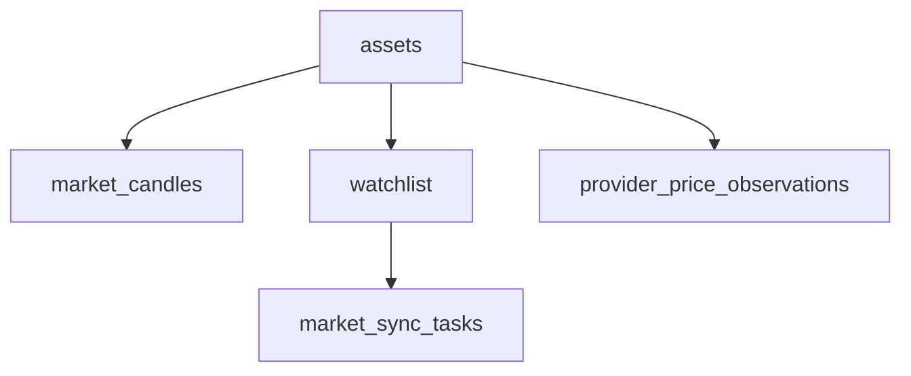
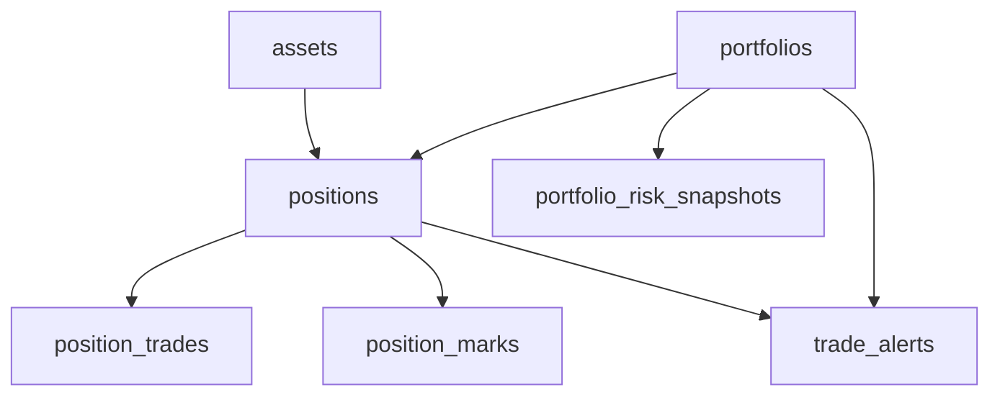
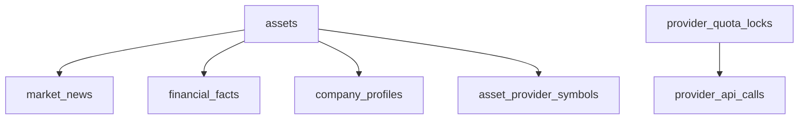

> État courant V11 du 21 novembre 2026 : **48 tables métier et 410 colonnes**, hors Flyway. L’extension informations V9 à V11 et ses colonnes sont décrites en fin de document ; les sections V8 conservent le détail du socle antérieur.

# Base de données Bourse AI

Schéma réel après application de Flyway V1 à V8 sur PostgreSQL 17.7, le 20 novembre 2026. Les 42 tables et 357 colonnes ci-dessous sont extraites de cette base de test ; leur rôle correspond au code livré. Le document d’analyse version 1.2 accompagne cette livraison.

## Données de marché

Un actif possède plusieurs bougies. Les observations par fournisseur conservent leur provenance ; la série canonique est celle utilisée pour les calculs. La liste de suivi crée des tâches d’import pour chaque intervalle, sans recopier les caractéristiques de l’actif.

## Portefeuille et suivi

Une position décrit ce qui reste détenu. Les achats et ventes sont conservés séparément dans le journal, tandis que la dernière valorisation sert au calcul du risque. Une vente ne supprime jamais ses pertes réalisées du portefeuille.

## Informations et quotas

Les tables existantes V1 à V5 sont conservées. V6 ajoute le suivi, les positions et les alertes, ainsi qu’un verrou technique de capacité. V7 ajoute neuf tables pour les publications sociales, les événements, leurs scores et le plafond de collecte X. Aucun mot de passe ni token fournisseur n’est stocké dans ces tables.

## Conventions

- Les prix et sommes utilisent des types décimaux, jamais des nombres flottants binaires.
- Les horodatages sont stockés comme instants UTC ; les horaires de marché utilisent un fuseau IANA distinct.
- `base` désigne la devise du portefeuille ; `quote` la devise de cotation de l’actif.
- Les colonnes d’audit décrivent le stockage ; elles ne remplacent pas la date de marché, de publication ou d’exécution.
- La colonne « obligatoire » indique la contrainte NOT NULL. Les clés et contraintes composées sont précisées sous chaque table.
- Aucun DELETE en cascade n’est défini pour les journaux financiers. Les corrections d’exécutions passées et les dépôts/retraits après création restent à développer.

## Dictionnaire des colonnes

### assets

Référentiel commun des actions et cryptomonnaies.

| Colonne | Type PostgreSQL | Obligatoire | Signification |
|---|---|---|---|
| `id` | `bigint` | Oui | Clé primaire de l’actif ; utilisée par prix, actualités, suivi et positions. |
| `symbol` | `character varying(40)` | Oui | Identifiant interne unique ; un code de place dans le symbole évite les collisions. |
| `name` | `character varying(255)` | Oui | Nom lisible affiché à l’utilisateur. |
| `asset_type` | `character varying(16)` | Oui | STOCK ou CRYPTO ; aucun type FOREX de portefeuille dans ce lot. |
| `currency` | `character varying(3)` | Oui | Devise de cotation à trois lettres, à distinguer de la devise du portefeuille. |
| `created_time` | `timestamp with time zone` | Oui | Date technique de création de l’enregistrement, en UTC. |
| `updated_time` | `timestamp with time zone` | Oui | Date de dernière modification écrite par le service ; aucun trigger global automatique. |

Clé primaire `id`, unicité de `symbol`. Deux titres homonymes de places différentes doivent recevoir des symboles internes distincts.

### market_candles

Séries OHLCV canoniques utilisées par les indicateurs et les graphiques.

| Colonne | Type PostgreSQL | Obligatoire | Signification |
|---|---|---|---|
| `id` | `bigint` | Oui | Identifiant technique généré par la base, sauf pour les tables de verrou. |
| `asset_id` | `bigint` | Oui | Référence vers assets.id ; identifie l’instrument sans répéter ses caractéristiques. |
| `timeframe` | `character varying(8)` | Oui | Durée de bougie : 1m, 15m, 30m, 1h ou 1d selon la route. |
| `open_time` | `timestamp with time zone` | Oui | Début de la bougie en UTC ; distinct de sa date de réception. |
| `open_price` | `numeric(24,10)` | Oui | Prix d’ouverture dans la devise de cotation. |
| `high_price` | `numeric(24,10)` | Oui | Prix le plus haut de la bougie dans la devise de cotation. |
| `low_price` | `numeric(24,10)` | Oui | Prix le plus bas de la bougie dans la devise de cotation. |
| `close_price` | `numeric(24,10)` | Oui | Prix de clôture de la bougie dans la devise de cotation. |
| `volume` | `numeric(28,8)` | Oui | Volume déclaré par la source ; ne pas remplacer une donnée absente par zéro. |
| `provider` | `character varying(64)` | Oui | Nom du fournisseur ou de la provenance technique. |
| `created_time` | `timestamp with time zone` | Oui | Date technique de création de l’enregistrement, en UTC. |
| `updated_time` | `timestamp with time zone` | Oui | Date de dernière modification écrite par le service ; aucun trigger global automatique. |

Unicité `(asset_id, timeframe, open_time)`. Contrôles SQL des prix positifs et OHLC cohérents. Un réimport ignore les bougies déjà présentes ; la correction des historiques reste à implémenter.

### watchlist

Actifs à suivre, symboles Twelve Data et horaires réguliers de séance.

| Colonne | Type PostgreSQL | Obligatoire | Signification |
|---|---|---|---|
| `asset_id` | `bigint` | Oui | Référence vers assets.id ; identifie l’instrument sans répéter ses caractéristiques. |
| `provider_symbol` | `character varying(80)` | Oui | Symbole compris par ce fournisseur ; peut différer du symbole interne. |
| `region` | `character varying(12)` | Oui | US, EU ou GLOBAL ; information de couverture, pas un score financier. |
| `market_zone` | `character varying(80)` | Oui | Fuseau IANA de la séance, par exemple America/New_York ; gère les changements d’heure. |
| `session_open` | `character varying(5)` | Oui | Début de la séance régulière au format HH:mm, heure locale du marché. |
| `session_close` | `character varying(5)` | Oui | Fin exclusive de la séance régulière ; non utilisée pour les cryptos. |
| `enabled` | `boolean` | Oui | Active ou désactive la production de tâches pour cet actif. |
| `created_time` | `timestamp with time zone` | Oui | Date technique de création de l’enregistrement, en UTC. |
| `updated_time` | `timestamp with time zone` | Oui | Date de dernière modification écrite par le service ; aucun trigger global automatique. |

Clé primaire `asset_id`. Plafonds applicatifs : 100 actions actives et 30 cryptos actives. L’ordonnanceur consulte maintenant les séances de market_sessions : fériés et clôtures anticipées inclus pour les calendriers importés et le calendrier US fourni.

### market_sync_tasks

File persistante de synchronisation avec états, tentatives et bail de reprise.

| Colonne | Type PostgreSQL | Obligatoire | Signification |
|---|---|---|---|
| `id` | `bigint` | Oui | Identifiant technique généré par la base, sauf pour les tables de verrou. |
| `asset_id` | `bigint` | Oui | Référence vers assets.id ; identifie l’instrument sans répéter ses caractéristiques. |
| `timeframe` | `character varying(8)` | Oui | Durée de bougie : 1m, 15m, 30m, 1h ou 1d selon la route. |
| `slot_time` | `timestamp with time zone` | Oui | Créneau UTC d’import ; sert avec actif et intervalle à dédupliquer la tâche. |
| `status` | `character varying(20)` | Oui | État métier ou technique, dont les valeurs sont précisées sous la table. |
| `attempts` | `integer` | Oui | Nombre de prises en charge, y compris celles ensuite différées par quota. |
| `next_attempt_at` | `timestamp with time zone` | Oui | Instant minimal pour une prochaine tentative. |
| `lease_until` | `timestamp with time zone` | Non | Expiration du bail de traitement, qui permet la reprise après interruption. |
| `error_code` | `character varying(80)` | Non | Code local assaini, par exemple LOCAL_QUOTA ou HTTP_502. |
| `imported_count` | `integer` | Oui | Nombre de bougies nouvelles lors de la dernière exécution réussie. |
| `created_time` | `timestamp with time zone` | Oui | Date technique de création de l’enregistrement, en UTC. |
| `updated_time` | `timestamp with time zone` | Oui | Date de dernière modification écrite par le service ; aucun trigger global automatique. |

États : PENDING, RUNNING, DEFERRED, SUCCEEDED, FAILED. Unicité `(asset_id, timeframe, slot_time)`. Le bail est un mécanisme de reprise ; la déduplication finale des bougies reste nécessaire.

### portfolios

Capital initial, devise de référence et limite de perte globale.

| Colonne | Type PostgreSQL | Obligatoire | Signification |
|---|---|---|---|
| `id` | `bigint` | Oui | Identifiant technique généré par la base, sauf pour les tables de verrou. |
| `name` | `character varying(120)` | Oui | Nom lisible affiché à l’utilisateur. |
| `base_currency` | `character varying(3)` | Oui | Devise commune utilisée pour le capital, la trésorerie et les limites. |
| `initial_capital` | `numeric(24,8)` | Oui | Capital de référence initial ; les dépôts/retraits ultérieurs ne sont pas encore modélisés. |
| `max_loss_amount` | `numeric(24,8)` | Oui | Perte nette maximale de référence en devise de base ; ce n’est pas une garantie d’exécution. |
| `risk_latched` | `boolean` | Oui | Mémorise une alerte de perte déjà émise ; réarmé après retour à un état sain. |
| `created_time` | `timestamp with time zone` | Oui | Date technique de création de l’enregistrement, en UTC. |
| `updated_time` | `timestamp with time zone` | Oui | Date de dernière modification écrite par le service ; aucun trigger global automatique. |

Le budget est global et exprimé en devise de base. La référence est le capital initial, pas le plus haut historique atteint.

### positions

Quantités restantes et coût de revient d’une position déclarée.

| Colonne | Type PostgreSQL | Obligatoire | Signification |
|---|---|---|---|
| `id` | `bigint` | Oui | Identifiant technique généré par la base, sauf pour les tables de verrou. |
| `portfolio_id` | `bigint` | Oui | Référence vers portfolios.id ; rattache la donnée au portefeuille. |
| `asset_id` | `bigint` | Oui | Référence vers assets.id ; identifie l’instrument sans répéter ses caractéristiques. |
| `quantity` | `numeric(28,8)` | Oui | Nombre de titres ou unités de crypto ; fractions possibles sur huit décimales. |
| `average_entry_quote` | `numeric(24,10)` | Oui | Moyenne pondérée des prix d’achat, hors frais, dans la devise de l’actif. |
| `remaining_cost_base` | `numeric(24,8)` | Oui | Coût de revient des unités restantes en devise de base, frais d’achat inclus. |
| `horizon` | `character varying(12)` | Oui | SHORT, MEDIUM ou LONG ; sélectionne l’unité de temps du signal de révision. |
| `signal_timeframe` | `character varying(8)` | Oui | 15m pour SHORT, 1h pour MEDIUM et 1d pour LONG dans cette version. |
| `opened_at` | `timestamp with time zone` | Oui | Date et heure du premier achat déclaré de cette position. |
| `status` | `character varying(12)` | Oui | État métier ou technique, dont les valeurs sont précisées sous la table. |
| `created_time` | `timestamp with time zone` | Oui | Date technique de création de l’enregistrement, en UTC. |
| `updated_time` | `timestamp with time zone` | Oui | Date de dernière modification écrite par le service ; aucun trigger global automatique. |

États OPEN ou CLOSED. Une quantité nulle clôture la position ; la ligne et son historique sont conservés.

### position_trades

Journal immuable des achats et ventes déclarés, frais, FX et trésorerie.

| Colonne | Type PostgreSQL | Obligatoire | Signification |
|---|---|---|---|
| `id` | `bigint` | Oui | Identifiant technique généré par la base, sauf pour les tables de verrou. |
| `position_id` | `bigint` | Oui | Référence vers positions.id ; peut être absent pour une alerte globale. |
| `portfolio_id` | `bigint` | Oui | Référence vers portfolios.id ; rattache la donnée au portefeuille. |
| `client_order_id` | `character varying(80)` | Oui | Identifiant client stable et unique dans le portefeuille ; évite les doubles saisies réseau. |
| `side` | `character varying(4)` | Oui | BUY ou SELL ; déclaration d’une exécution, aucun ordre transmis au courtier. |
| `quantity` | `numeric(28,8)` | Oui | Nombre de titres ou unités de crypto ; fractions possibles sur huit décimales. |
| `price_quote` | `numeric(24,10)` | Oui | Prix unitaire dans la devise de cotation de l’actif. |
| `fees_quote` | `numeric(24,10)` | Oui | Frais de cette opération dans la devise de cotation ; montant positif ou nul. |
| `fx_to_base` | `numeric(24,10)` | Oui | Valeur d’une unité de devise de cotation dans la devise du portefeuille ; 1 si identiques. |
| `cash_delta_base` | `numeric(24,8)` | Oui | Mouvement de trésorerie net en devise de base ; négatif à l’achat, positif à la vente. |
| `realized_pnl_base` | `numeric(24,8)` | Oui | Résultat réalisé net de la quantité vendue selon le coût moyen ; nul pour un achat. |
| `executed_at` | `timestamp with time zone` | Oui | Instant de l’exécution déclarée ; ne peut pas précéder l’opération précédente. |
| `created_time` | `timestamp with time zone` | Oui | Date technique de création de l’enregistrement, en UTC. |

Unicité `(portfolio_id, client_order_id)`. Les achats sont limités à la trésorerie disponible et les ventes à la quantité détenue ; aucune suppression par cascade des données financières.

### position_marks

Dernier prix et conversion explicites utilisés pour valori…8837 tokens truncated…es utilisées ; sinon la qualification n’est pas appliquée.

### seasonality_runs

Résultats historiques mensuels, trimestriels et annuels enregistrés.

| Colonne | Type PostgreSQL | Obligatoire | Signification |
|---|---|---|---|
| `id` | `bigint` | Oui | Identifiant interne de la ligne. |
| `asset_id` | `bigint` | Oui | Clé étrangère vers assets. |
| `as_of` | `timestamp with time zone` | Oui | Instant de référence de l’analyse. |
| `computed_at` | `timestamp with time zone` | Oui | Instant réel du calcul. |
| `method` | `character varying(64)` | Oui | Identifiant versionné de la méthode. |
| `input_hash` | `character varying(64)` | Oui | SHA-256 des dates, clôtures et fournisseurs de la série utilisée. |
| `result_json` | `text` | Oui | Résultat complet conservé en JSON texte. |

Snapshots conservés ; statistiques exploratoires, usableForScoring=false. Les périodes incomplètes et les séries présentant de grands trous ne deviennent pas un signal.

### information_sources

Catalogue administrateur des flux publics, activations et reprises.

| Colonne | Type PostgreSQL | Obligatoire | Signification |
|---|---|---|---|
| `code` | `character varying(60)` | Oui | Identifiant stable de configuration. |
| `name` | `character varying(180)` | Oui | Nom lisible de la configuration ou de la source. |
| `feed_url` | `character varying(1500)` | Oui | Adresse HTTPS du RSS/Atom à télécharger, issue d’un catalogue de confiance. |
| `evidence_url` | `character varying(1500)` | Oui | URL HTTPS justifiant la configuration ou la validation humaine. |
| `region` | `character varying(30)` | Oui | Portée géographique indicative. |
| `language_code` | `character varying(12)` | Oui | Langue principale annoncée. |
| `enabled` | `boolean` | Oui | Activation explicite ; false par défaut. |
| `publisher_actor_id` | `bigint` | Non | Clé étrangère vers le compte éditeur institutionnel ou média, pas un locuteur supposé. |
| `etag` | `character varying(1000)` | Non | Validateur HTTP facultatif pour requêtes conditionnelles. |
| `last_modified` | `character varying(1000)` | Non | Dernière valeur HTTP Last-Modified connue. |
| `next_attempt_at` | `timestamp with time zone` | Non | Prochain instant autorisé, incluant intervalle minimal et backoff. |
| `lease_until` | `timestamp with time zone` | Non | Expiration du bail réseau ; la requête est réalisée hors transaction longue. |
| `lease_token` | `character varying(40)` | Non | Identifiant de tentative qui interdit à un ancien worker de publier après reprise ; pas un token fournisseur. |
| `last_success_at` | `timestamp with time zone` | Non | Dernière collecte ou réponse 304 réussie. |
| `last_error` | `character varying(120)` | Non | Code d’échec assaini, sans réponse distante ni clé. |
| `created_time` | `timestamp with time zone` | Oui | Instant de création en base. |
| `updated_time` | `timestamp with time zone` | Oui | Instant de dernière modification en base. |

Clé primaire code. Douze flux fournis, désactivés par défaut. Les sources sont indépendantes du quota de cours et de X. Les URLs ne sont pas acceptées depuis un article ou un appel REST arbitraire.

### information_items

Titres et résumés RSS/Atom, avec révisions et disponibilité.

| Colonne | Type PostgreSQL | Obligatoire | Signification |
|---|---|---|---|
| `id` | `bigint` | Oui | Identifiant interne de la ligne. |
| `source_code` | `character varying(60)` | Oui | Clé étrangère vers information_sources. |
| `external_key` | `character varying(64)` | Oui | SHA-256 du GUID/id ou lien stable fourni par le flux. |
| `content_hash` | `character varying(64)` | Oui | SHA-256 du contenu, URL, date et auteur ; distingue les révisions. |
| `title` | `character varying(1000)` | Oui | Titre collecté. |
| `summary` | `text` | Oui | Résumé textuel nettoyé du balisage ; aucun contournement d’accès à l’article. |
| `original_url` | `character varying(1500)` | Oui | Lien HTTPS original à ouvrir pour vérifier l’information. |
| `author_text` | `character varying(300)` | Non | Champ auteur brut de la source, sans certification du locuteur. |
| `published_at` | `timestamp with time zone` | Non | Date originale de publication, NULL si absente ou illisible. |
| `collected_at` | `timestamp with time zone` | Oui | Date réelle de collecte. |
| `publication_id` | `bigint` | Non | Clé étrangère vers social_publications. |
| `review_status` | `character varying(24)` | Oui | PENDING_REVIEW, DATE_MISSING ou FUTURE_DATE. Une date absente n’est pas remplacée par l’heure de collecte. |

Unicité (source_code, external_key, content_hash). Les versions précédentes restent intactes. publication_id reste NULL si la date est inutilisable.

### information_mentions

Noms de personnes suivies rencontrés dans le texte collecté.

| Colonne | Type PostgreSQL | Obligatoire | Signification |
|---|---|---|---|
| `item_id` | `bigint` | Oui | Clé étrangère vers information_items. |
| `actor_id` | `bigint` | Oui | Clé étrangère vers social_actors. |
| `matched_name` | `character varying(160)` | Oui | Nom exact du compte suivi qui a correspondu au texte. |
| `attribution_status` | `character varying(24)` | Oui | NAME_MATCH_ONLY ou HUMAN_VERIFIED_QUOTE. |
| `evidence` | `character varying(1500)` | Non | Preuve saisie lors d’une attribution humaine. |

Clé primaire (item_id, actor_id). Une correspondance de nom ne prouve jamais que cette personne a prononcé les mots.

### information_attributions

Passages attribués à un acteur après validation humaine explicite.

| Colonne | Type PostgreSQL | Obligatoire | Signification |
|---|---|---|---|
| `id` | `bigint` | Oui | Identifiant interne de la ligne. |
| `item_id` | `bigint` | Oui | Clé étrangère vers information_items. |
| `actor_id` | `bigint` | Oui | Clé étrangère vers social_actors. |
| `quote_hash` | `character varying(64)` | Oui | SHA-256 du passage exact. |
| `exact_quote` | `character varying(2000)` | Oui | Passage de 10 à 2 000 caractères présent dans le texte collecté. |
| `evidence_url` | `character varying(1500)` | Oui | URL HTTPS justifiant la configuration ou la validation humaine. |
| `publication_id` | `bigint` | Oui | Clé étrangère vers social_publications. |
| `verified_at` | `timestamp with time zone` | Oui | Instant où la validation humaine a été déclarée à l’API. |

Unicité (item_id, actor_id, quote_hash). La publication reliée porte HUMAN_VERIFIED_QUOTE et conserve la date et le lien original. Le code contrôle la présence du passage, pas la vérité de l’attribution.

### information_sync_runs

Journal des tentatives de collecte, y compris les reprises.

| Colonne | Type PostgreSQL | Obligatoire | Signification |
|---|---|---|---|
| `id` | `bigint` | Oui | Identifiant interne de la ligne. |
| `source_code` | `character varying(60)` | Oui | Clé étrangère vers information_sources. |
| `started_at` | `timestamp with time zone` | Oui | Début de la tentative. |
| `finished_at` | `timestamp with time zone` | Non | Fin, absente si en cours. |
| `status` | `character varying(24)` | Oui | État explicite du traitement. |
| `inserted_count` | `integer` | Oui | Nombre de nouvelles versions d’articles insérées. |
| `error_code` | `character varying(120)` | Non | Code technique assaini. |

États RUNNING, SUCCEEDED, NOT_MODIFIED, FAILED, ABANDONED ou LEASE_LOST. Une reprise après expiration marque l’ancien traitement abandonné.

### explanation_guard

Verrou technique des versions et snapshots explicatifs.

| Colonne | Type PostgreSQL | Obligatoire | Signification |
|---|---|---|---|
| `id` | `integer` | Oui | Identifiant interne de la ligne. |

Singleton id=1. Les calculs sont sérialisés dans cette première version ; aucun verrou de prix ou de portefeuille n’est requis pour expliquer un score.

### explanation_rulesets

Versions immuables des poids et seuils du score expérimental.

| Colonne | Type PostgreSQL | Obligatoire | Signification |
|---|---|---|---|
| `id` | `bigint` | Oui | Identifiant interne de la ligne. |
| `name` | `character varying(120)` | Oui | Nom lisible de la configuration ou de la source. |
| `method` | `character varying(64)` | Oui | Identifiant versionné de la méthode. |
| `configuration_json` | `text` | Oui | Poids technique/fondamental/information, seuil de variation de marge et seuils RSI. |
| `created_at` | `timestamp with time zone` | Oui | Instant de création de la version. |

Unicité name. Les défauts DAY, MONTH, YEAR sont conservés ; toute expérience crée une nouvelle version. Amplitudes non négatives, somme entre 1 et 50.

### explanation_snapshots

Explication complète et datée d’un score par actif et horizon.

| Colonne | Type PostgreSQL | Obligatoire | Signification |
|---|---|---|---|
| `id` | `bigint` | Oui | Identifiant interne de la ligne. |
| `asset_id` | `bigint` | Oui | Clé étrangère vers assets. |
| `ruleset_id` | `bigint` | Oui | Clé étrangère vers explanation_rulesets. |
| `horizon` | `character varying(12)` | Oui | DAY, MONTH ou YEAR, sélectionnant respectivement les séries 15m, 1h ou 1d. |
| `as_of` | `timestamp with time zone` | Oui | Instant de référence de l’analyse. |
| `computed_at` | `timestamp with time zone` | Oui | Instant réel du calcul. |
| `score` | `numeric(8,4)` | Non | Score indicatif de 0 à 100 ; NULL si aucune composante exploitable. |
| `coverage_score` | `integer` | Oui | Part des composantes actives disponibles ; pas une probabilité de gain. |
| `status` | `character varying(48)` | Oui | État explicite du traitement. |
| `result_json` | `text` | Oui | Résultat complet conservé en JSON texte. |

Le résultat conserve facteurs, preuves, état des prix, règles, précédent snapshot et variations. Les données manquantes, anciennes ou ambiguës sont signalées explicitement. Les résultats sont review-only.

### explanation_factors

Détail des contributions d’une analyse pour l’affichage mobile futur.

| Colonne | Type PostgreSQL | Obligatoire | Signification |
|---|---|---|---|
| `id` | `bigint` | Oui | Identifiant interne de la ligne. |
| `snapshot_id` | `bigint` | Oui | Clé étrangère vers explanation_snapshots. |
| `factor_key` | `character varying(120)` | Oui | Clé de règle ou d’événement, utilisée pour comparer deux analyses. |
| `category` | `character varying(24)` | Oui | TECHNICAL, FUNDAMENTAL, INFORMATION ou SEASONALITY. |
| `points` | `numeric(8,4)` | Oui | Contribution signée exacte au score ; zéro pour une saisonnalité non validée. |
| `explanation` | `character varying(2000)` | Oui | Formule, valeurs ou motif expliquant la contribution. |
| `evidence_json` | `text` | Oui | Valeurs, identifiants, périodes et sources utilisés, conservés en JSON texte. |

Unicité (snapshot_id, factor_key). La somme des différences de contributions correspond à la variation du score lorsque les deux scores sont calculables.

## Entretien du schéma

Utiliser une nouvelle migration pour chaque évolution. Les tests ont vérifié V1 à V8 depuis une base vide et V7 vers V8 avec données existantes, sur H2 et PostgreSQL 17.7. Ils ne modifient pas la base du PC. Le schéma de cette livraison contient 42 tables et 357 colonnes, hors historique Flyway.

## Extension informations V9 à V11

Le schéma contrôlé après migrations compte **48 tables métier et 410 colonnes**, hors historique Flyway, dans la validation PostgreSQL du 21 novembre 2026. Le schéma Python ML `bourse_ml` est séparé.

| Table | Clés et colonnes | Rôle |
|---|---|---|
| `information_worker_guard` | `id` PK | Sérialise brièvement l'ajout et la réservation des tâches |
| `information_contents` | `id` PK ; `item_id` FK ; `content_hash`, `body_text`, `scope`, `content_url`, `extraction_method`, `fetch_error`, `segments_json`, `fetched_at` | Contenu conservé avant analyse ; unicité item et empreinte ; résumé seul, extrait ou transcription explicités |
| `information_ai_jobs` | `id` PK ; `item_id` FK ; `model`, `prompt_version`, `status`, `attempts`, `lease_token`, `lease_until`, `next_attempt_at`, `content_id` FK, `error_code`, `created_time`, `updated_time` | Tâche unique par item, modèle et consigne ; bail renouvelable et reprises bornées |
| `information_ai_analyses` | `id` PK ; `job_id` FK unique ; `content_id` FK ; `result_json`, `analyzed_characters`, `review_status`, `review_reason`, `reviewed_at`, `created_time` | Proposition immuable et état courant de revue ; résumé, événements et preuves dans le JSON |
| `information_ai_impacts` | `id` PK ; `analysis_id`, `asset_id` FK ; `event_key`, `event_group`, `horizon`, `direction`, `proposed_score`, `explanation`, `exact_quote` | Impact proposé par événement, actif et horizon ; score null si sens mixte ou inconnu |
| `information_ai_reviews` | `id` PK ; `analysis_id` FK ; `decision`, `reason`, `event_groups_json`, `reviewed_at` | Journal conservé lors d'une approbation ou d'un retrait |

`information_sources` reçoit `content_kind` (ARTICLE ou PODCAST) et `publisher_group` (regroupement d'éditeur, pas une preuve de corroboration). `information_items` reçoit `audio_url` et `transcript_url`. Son `summary` reste le résumé original du flux. Les contenus et propositions conservent leurs dates de création ; seules la tâche et la projection de l'état de revue changent. Les snapshots d'explication déjà enregistrés ne sont pas réécrits.

Les dates de publication, collecte, récupération, calcul et revue restent distinctes. Un futur jeu d'apprentissage devra utiliser la disponibilité effective des composantes, jamais seulement la date ancienne d'un article analysé aujourd'hui. Les révisions d'un même item restent consultables, mais une ancienne révision approuvée ne continue pas à contribuer au score courant après réception d'une correction.
