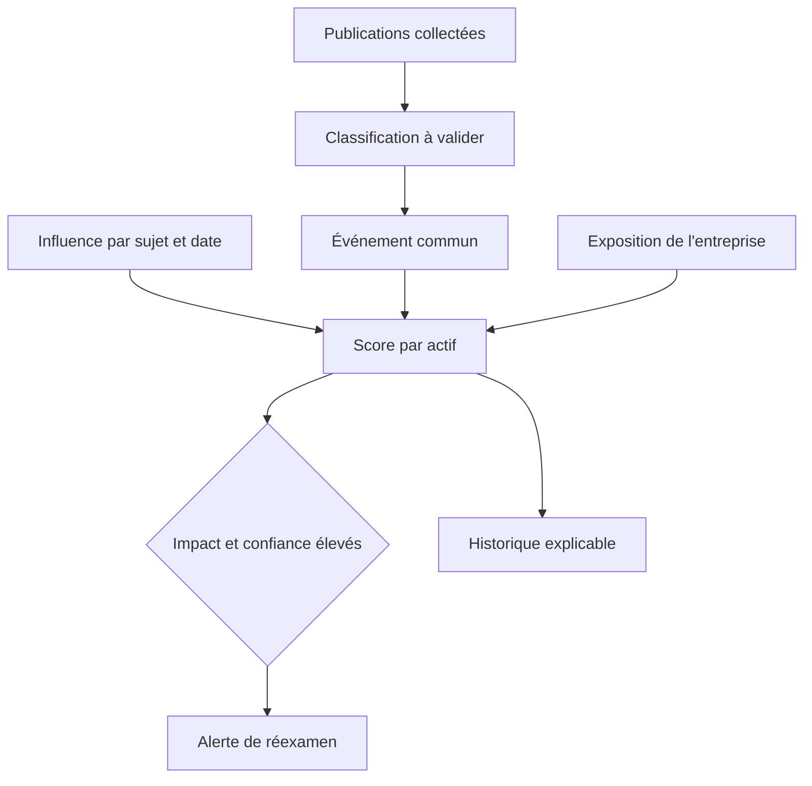

# Publications sociales et événements de marché

Ajout du 19 novembre 2026. Ce module étend le code du lot 3. Il ne modifie pas le document d’analyse Word/PDF et ne constitue pas une stratégie de trading validée.

## Fonctionnement livré

Une personne possède un compte suivi et des profils d’influence par sujet, avec un intervalle de validité. Par exemple, la capacité d’un responsable à modifier des tarifs douaniers ne lui donne pas automatiquement la même compétence sur les résultats d’une entreprise. Les profils sont configurés et justifiés manuellement ; aucun classement réel des personnalités n’est fourni par défaut.

Les publications conservent leur texte, leur URL, leur date de publication et leur date de collecte. Les reprises d’une annonce doivent être rattachées au même événement canonique. Chaque événement reçoit ensuite une évaluation distincte pour chaque action ou crypto concernée. Une hausse des coûts d’importation et une protection contre les importations peuvent avoir des conséquences opposées selon les entreprises ; le sens de l’effet reste une hypothèse à justifier.



Le texte d’une publication est une donnée à examiner. Il n’est jamais exécuté comme une instruction. À ce stade, la classification des événements, l’identité des comptes, les confirmations et les expositions sont **validées manuellement via l’API**. Aucun LLM ni extracteur sémantique automatique n’est encore connecté. Le collecteur n’invente ni entité, ni date, ni score lorsqu’il télécharge un texte.

## Calcul initial

Version : `SOCIAL_EVENT_V1_HEURISTIC`. Tous les facteurs d’entrée sont compris entre 0 et 100.

```text
base = 0.25 × autorité_sur_le_sujet
     + 0.50 × importance_économique
     + 0.25 × nouveauté

impact_potentiel = base × pertinence_pour_actif/100 × fraîcheur
fraîcheur = 2 ^ (-âge_publication / demi_vie)
confiance = min(confiance_analyste, plafond_de_confirmation, plafond_identité)
score_signé = sens × impact_potentiel × confiance/100
```

Ces coefficients sont un point de départ explicite, à calibrer par backtests chronologiques. Un score de 80 ne signifie ni 80 % de probabilité de hausse ni 80 % de rendement attendu.

| Facteur | Traitement dans le code |
|---|---|
| Influence de l’auteur | Profil applicable au sujet et à la date de la publication ; 0 en l’absence de profil |
| Plusieurs auteurs/reprises | Maximum des autorités applicables ; jamais une somme de popularités |
| Importance économique | Matérialité de l’information pour le scénario étudié |
| Exposition | Pertinence pour l’entreprise ou la crypto ; aucun sens identique imposé à tout un secteur |
| Nouveauté | Évaluation manuelle ; une information déjà intégrée peut recevoir une note faible |
| Ancienneté | Date de la première publication liée active, jamais l’heure du dernier repost |
| Sens | POSITIVE, NEGATIVE, MIXED ou UNKNOWN ; score signé NULL pour les deux derniers |
| Information retirée | Impact et confiance ramenés à 0 ; historique conservé |

| Confirmation déclarée | Plafond de confiance |
|---|---:|
| UNCONFIRMED | 35 |
| AUTHOR_STATEMENT | 65 |
| CORROBORATED | 85 |
| OFFICIAL_DOCUMENT | 95 |

Une rumeur reste plafonnée à 35 même si une classification incohérente indique « document officiel ». Un compte dont l’identité n’a pas été confirmée reste plafonné à 30. Une URL justificative est obligatoire pour déclarer une identité confirmée ; sa vérification est humaine, pas automatique. Les plafonds sont des règles de prudence, pas des probabilités mesurées.

| Horizon de l’effet étudié | Demi-vie initiale |
|---|---:|
| INTRADAY | 15 minutes |
| DAYS | 1 jour |
| MONTHS | 30 jours |
| YEARS | 365 jours |

L’horizon concerne la durée supposée de l’effet, indépendamment de l’horizon de détention. Ces demi-vies ne sont pas calibrées. Le score enregistré est une photographie à `scored_at` ; il faut invoquer `rescore` pour l’actualiser. Aucun ordonnanceur social n’est activé.

## Alertes et corrections

Si l’impact potentiel atteint 70 et la confiance 50, une alerte `SOCIAL_EVENT_REVIEW` est enregistrée pour chaque position ouverte sur l’actif. La clé `(type, événement, position)` évite de répéter l’alerte à chaque calcul. Même une direction inconnue peut justifier un réexamen si l’événement est majeur.

Le retrait explicite d’un événement recalcule ses évaluations à zéro et produit une alerte `SOCIAL_EVENT_CORRECTION`. Les précédents scores et alertes restent consultables. Une correction de texte doit être conservée sous un nouvel identifiant de publication ; le contenu d’origine n’est pas écrasé silencieusement.

Ces alertes ne modifient pas la limite de perte du portefeuille, n’exécutent aucun ordre et ne sont pas encore envoyées en push Android. Le score social reste séparé du MACD et des autres informations : leur combinaison dans un score global et les règles de priorité doivent encore être validées. Ne jamais additionner l’historique des recalculs ni compter la même annonce à la fois comme plusieurs événements sociaux, nouvelles et podcasts. Le rattachement transversal news/podcasts reste à développer.

## Collecte X facultative

Le collecteur utilise `GET /2/users/{id}/tweets`, avec `post.fields=created_at`, `exclude=retweets` et cinq publications au maximum par page, sans récupération des profils ou statistiques de followers. Il exige un compte X dont l’identité a été déclarée confirmée et son identifiant numérique. Une invocation traite une page ; `morePages=true` demande de poursuivre explicitement.

Le curseur `since_id` n’avance qu’après la dernière page. Le jeton de pagination et le plus grand identifiant rencontré sont persistés entre les appels. Une réponse partielle, un ID ou une date manquants font annuler l’insertion de la page et la mise à jour du curseur.

Configuration par défaut :

```dotenv
SOCIAL_X_ENABLED=false
SOCIAL_X_BEARER_TOKEN=
SOCIAL_X_MONTHLY_POST_LIMIT=0
```

Une clé et une limite explicites sont nécessaires avant tout appel. Chaque tentative réserve cinq lectures dans une transaction indépendante, sous un verrou partagé par les instances. Les échecs conservent cette réservation, même si la page entière est annulée. Le plafond suit le mois civil UTC et compte les réservations, donc peut arrêter la collecte plus tôt que la consommation réelle. Ce n’est pas un plafond monétaire ni une reproduction de la facturation de X. Les limites de dépenses du compte fournisseur doivent être configurées séparément.

La documentation X consultée le 19 novembre 2026 indique une facturation à l’usage, avec des tarifs susceptibles de changer. Aucun crédit, abonnement, achat ou appel réel n’a été effectué pendant ce développement. Le budget de données de marché n’inclut pas automatiquement les réseaux sociaux.

Les autres plateformes peuvent alimenter la même API d’ingestion structurée, mais leurs collecteurs automatiques ne sont pas implémentés. La présence de `TRUTH_SOCIAL`, `LINKEDIN` ou `YOUTUBE` dans le référentiel ne signifie pas que leur API est connectée. Le contenu audio, vidéo, les images, l’édition complète et la suppression distante des publications ne sont pas synchronisés dans cette version.

Le client HTTP n’autorise pas les redirections, limite la connexion à 5 secondes et la lecture à 20 secondes. Les réponses d’erreur distantes et les tokens ne sont pas inclus dans les messages d’erreur. La collecte sérialise les appels d’un même compte par verrou SQL ; ce verrou reste tenu pendant la requête réseau. Un traitement par bail hors transaction est à envisager pour un grand volume.

## API de développement

Préfixe : `/api/v1/social`. Ces endpoints héritent du backend de développement sans authentification ; ils doivent rester privés tant que l’authentification n’est pas ajoutée.

| Méthode et route | Rôle |
|---|---|
| POST /actors ; GET /actors | Enregistrer/lister les comptes suivis |
| POST /actors/{id}/profiles | Définir l’influence par sujet et dates ; chevauchement refusé |
| POST /actors/{id}/sync-x | Collecter une page X si explicitement configuré |
| POST /publications ; GET /publications | Ingérer/lister les publications ; maximum 200 à la lecture |
| POST /events ; GET /events | Créer/lister les événements canoniques ; maximum 200 à la lecture |
| PUT /events/{id}/publications/{publicationId} | Rattacher une reprise au même événement et recalculer |
| PUT /events/{id}/assessment | Évaluer un actif et enregistrer un score |
| PUT /events/{id}/revision | Confirmer, dégrader ou retirer l’événement et recalculer |
| POST /events/{id}/rescore | Recalculer avec l’ancienneté actuelle |
| GET /events/{id}/scores | Historique des 200 derniers scores, récents en premier |

Les sujets sont `TARIFFS`, `MONETARY_POLICY`, `CORPORATE`, `CRYPTO`, `GENERAL`. Les types sont `ANNOUNCEMENT`, `RUMOR`, `ENACTED`, `OPINION`, `RETRACTION`. `ENACTED` décrit une mesure entrée en vigueur ; une simple déclaration peut rester `ANNOUNCEMENT` même si l’auteur est puissant.

Exemple synthétique de profil :

```json
{
  "topic": "TARIFFS",
  "authorityScore": 90,
  "validFrom": "2026-01-01T00:00:00Z",
  "validUntil": null,
  "rationale": "Exemple fictif : compétence décisionnelle sur ce sujet."
}
```

Exemple synthétique d’évaluation d’un actif déjà enregistré, transmis à `PUT /events/{id}/assessment` :

```json
{
  "symbol": "IMPORTER",
  "direction": "NEGATIVE",
  "materiality": 90,
  "relevance": 80,
  "novelty": 100,
  "analystConfidence": 80,
  "horizon": "DAYS",
  "rationale": "Hypothèse fictive : hausse des coûts d'importation sans compensation immédiate."
}
```

Le code produit les notes et leur justification à partir de ces entrées. L’extraction automatique de ces valeurs depuis le texte reste à implémenter, puis à évaluer sur un corpus daté. Aucun modèle n’a démontré une capacité à anticiper les variations de cours par les tests logiciels actuels.

## Traçabilité et évolutions restantes

Chaque calcul conserve la version de l’événement, la méthode, les facteurs, le rôle, les profils d’autorité, les sources et dates dans `input_snapshot`. En backtest, un score n’est disponible qu’à `scored_at`, après collecte et classification ; l’attribuer rétroactivement à `published_at` introduirait une anticipation. Les profils historiques renseignés aujourd’hui ne deviennent pas pour autant une preuve de ce qui était connu à l’époque.

Prochaines étapes : extraction sémantique avec provenance et traitement multilingue ; vérification/corroboration des annonces ; résolution automatique des événements et tickers ; graphe d’exposition sectorielle et géographique ; nouveaux collecteurs autorisés ; recalcul planifié ; modèle de réaction mesuré sur prix historiques, avec référence de marché, spreads et latence ; combinaison avec news/podcasts/indicateurs ; interface Android et push.

Sources techniques : [API des publications d’un compte](https://docs.x.com/x-api/users/get-posts), [tarification X](https://docs.x.com/x-api/getting-started/pricing). Exemple historique : [décret américain du 2 avril 2025 sur les tarifs réciproques](https://www.govinfo.gov/app/details/DCPD-202500425/). Cet exemple ne présume pas des tarifs encore applicables aujourd’hui et ne prouve pas à lui seul la cause d’une variation boursière.
