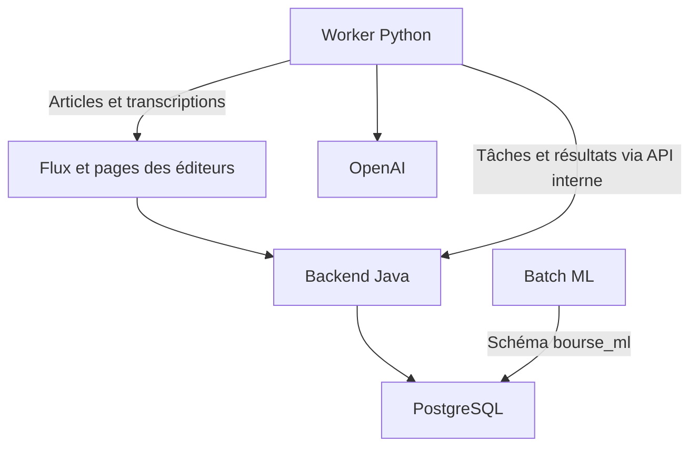

# Analyse des actualités et des podcasts

Module Python indépendant du batch d'apprentissage `bourse-ai-ml`. Java collecte les flux et conserve les tâches, contenus et résultats dans la même base PostgreSQL que le reste du backend. Ce worker accède à cette base **par l'API interne authentifiée de Java**, sans identifiants PostgreSQL ni droit d'écriture sur les prix ou les positions.



## Fonctionnement

1. Le collecteur Java interroge chaque source activée toutes les **3600 secondes** au minimum. Les intervalles des cours 15m/30m/1h/1d ne changent pas.
2. Le worker met en file les publications datées des **sept derniers jours** par défaut. Chaque passage ajoute au plus 200 tâches nouvelles ; un premier lancement ne déclenche pas l'analyse de toutes les archives d'un podcast.
3. Une réservation exclusive possède un bail de quinze minutes, renouvelé avant chaque analyse de passage. Les appels externes ne gardent pas de transaction SQL ouverte.
4. Le worker récupère un extrait lisible de l'article ou la transcription du podcast. Il conserve le résumé RSS original. Une page inaccessible ou explicitement payante reste en `SUMMARY_ONLY`, avec un code d'erreur ; aucun texte complet n'est inventé.
5. Le contenu est enregistré avant l'appel d'analyse. OpenAI reçoit des passages de 16 000 caractères, avec un chevauchement de 500 caractères, la liste des actifs connus et un contrat JSON strict.
6. Le résultat contient un résumé français, des incertitudes, les événements, les entreprises, les horizons, les interprétations et des citations exactes. Java revérifie les citations, les actifs, les bornes, la couverture du contenu et l'empreinte.
7. Les résultats restent `PROPOSED`. Une approbation opérateur tracée est nécessaire pour contribuer au score expérimental. Une approbation peut être retirée sans effacer l'historique.

`run` lit la file toutes les dix secondes : **ce n'est pas une interrogation des sites toutes les dix secondes**. `once` traite au plus une tâche puis se termine. Java doit fonctionner pour ces deux commandes. Les contenus, tâches et résultats sont durables avec le profil PostgreSQL ; la base H2 mémoire par défaut reste réservée aux essais.

## Sources

Les douze flux d'actualités existants restent disponibles : Fed (3), BCE, Bank of England (2), Trésor britannique, ONU, BBC Business, Le Monde Économie, Al Jazeera et France 24.

Deux flux de podcasts sont ajoutés au catalogue, **désactivés par défaut** :

| Code | Flux | Transcription |
|---|---|---|
| `RICHMOND_PODCAST` | `https://speakingoftheeconomy.libsyn.com/rss` | Lien officiel « Full transcript » dans la description ; conservé par Java |
| `RBC_TAKE` | `https://feeds.captivate.fm/the-10-minute-take/` | Page RBC `https://www.rbc.com/en/economics/the-10-minute-take/` ; sélection de l'épisode par son titre |

Un épisode RBC absent de la page n'hérite jamais de la transcription du dernier épisode. Il utilise son résumé ou, si elle est activée, la transcription de son audio. Les liens `podcast:transcript` sont reconnus. Les formats texte, JSON à segments, VTT/SRT et HTML de l'éditeur sont pris en charge. Les locuteurs et horaires sont conservés lorsqu'ils sont fournis ; une transcription audio simple ne crée pas de fausses identités ni d'horodatages mot à mot.

Les domaines des pages, transcriptions et fichiers audio doivent être explicitement autorisés. Les redirections sont revérifiées ; les destinations privées, identifiants dans les URL et ports non HTTPS sont refusés. Les lectures publiques utilisent un DNS public épinglé et une connexion TLS directe, sans cookies ni proxy d'environnement. Un réseau imposant un proxy nécessite une adaptation de transport contrôlée.

## Installation locale

Python **3.11 minimum**, testé avec 3.12 ; bibliothèque standard uniquement pour le worker. Depuis ce dossier :

```powershell
py -3.12 -m venv .venv
.\.venv\Scripts\python.exe -m pip install "setuptools>=75"
.\.venv\Scripts\python.exe -m pip install --no-deps --no-build-isolation -e .
```

Le venv doit disposer de setuptools 75 ou supérieur pour l'installation. Si nécessaire, l'installer avec `python -m pip install "setuptools>=75"`. Sans installer le package : définir `PYTHONPATH=src` puis utiliser `python -m bourse_ai_information`.

Sous Linux/macOS : `python3.12 -m venv .venv`, puis `.venv/bin/python`. Le fichier `.env.example` est documentaire, il n'est pas chargé automatiquement.

### Configuration Java

Générer **deux secrets distincts** avec un gestionnaire de secrets ou `python -c "import secrets; print(secrets.token_urlsafe(32))"` : un pour le worker, un pour l'opérateur de revue. Les définir dans l'environnement avant de démarrer Java :

```text
INFORMATION_AI_ENABLED=true
INFORMATION_WORKER_TOKEN=<secret-worker-au-moins-32-caracteres>
INFORMATION_REVIEW_TOKEN=<autre-secret-operateur-au-moins-32-caracteres>
INFORMATION_AI_MODEL=gpt-5.4-mini-2026-03-17
INFORMATION_AI_LOOKBACK_DAYS=7
INFORMATION_MINIMUM_INTERVAL_SECONDS=3600
INFORMATION_SCHEDULER_ENABLED=true
```

Conserver la configuration PostgreSQL habituelle du backend (`DB_URL`, `DB_USER`, `DB_PASSWORD`, profil `postgres`). Les migrations V9 à V11 sont automatiques. Les routes utilisateur restent des API de développement privées ; ces secrets de service ne remplacent pas une authentification des utilisateurs.

Activer uniquement les sources souhaitées, par exemple en PowerShell :

```powershell
Invoke-RestMethod -Method Put -Uri http://localhost:8081/api/v1/information/sources/FED_PRESS/enabled -ContentType application/json -Body '{"enabled":true}'
Invoke-RestMethod -Method Put -Uri http://localhost:8081/api/v1/information/sources/RICHMOND_PODCAST/enabled -ContentType application/json -Body '{"enabled":true}'
```

Pour un essai immédiat, `POST /api/v1/information/sources/FED_PRESS/sync` collecte ce flux sans attendre l'ordonnanceur. Le prochain appel respectera le délai horaire.

### Configuration du worker et clé OpenAI

Créer une clé de projet dans [OpenAI Platform](https://platform.openai.com/api-keys) et configurer la facturation API séparée de ChatGPT. La clé reste sur le serveur, jamais dans Android ni dans Git. Exemple de variables à définir dans le terminal du worker :

```text
INFORMATION_BACKEND_URL=http://127.0.0.1:8081
INFORMATION_WORKER_TOKEN=<meme-secret-worker-que-Java>
OPENAI_API_KEY=<cle-api-privee>
INFORMATION_OPENAI_ENABLED=true
INFORMATION_DAILY_MAX_CALLS=20
INFORMATION_DAILY_MAX_INPUT_BYTES=2000000
INFORMATION_STATE_DIR=state
INFORMATION_TRANSCRIBE_ENABLED=false
```

Le quota de 20 appels est **un exemple à choisir**, pas une promesse de coût. Les compteurs sont réservés dans SQLite avant chaque appel ; les échecs ambigus ne sont pas remboursés. La limite compte le volume d'entrée encodé, y compris l'audio, et le nombre d'appels par jour UTC. Elle ne constitue pas un plafond monétaire de facturation. La sortie de chaque analyse est limitée à 6000 tokens. Partager le même dossier d'état entre les workers d'une machine ; le déploiement sur plusieurs machines exige un budget centralisé.

```powershell
.\.venv\Scripts\python.exe -m bourse_ai_information once
.\.venv\Scripts\python.exe -m bourse_ai_information run
```

Sans clé, activation explicite et quotas positifs, aucun appel payant n'est lancé. Un quota épuisé reporte la tâche au prochain jour UTC sans épuiser les trois tentatives réseau. Un échec réseau peut être réessayé au plus trois fois, avec une heure de délai. Un appel distant réussi dont la réponse est perdue peut être facturé sans résultat local : le traitement n'annonce pas une facturation exactement une fois.

Les passages déjà analysés sont réutilisés après interruption. L'identité du cache inclut le modèle, la version de consigne, les actifs et le texte. Une nouvelle version de modèle est une nouvelle analyse, jamais une réécriture silencieuse.

### Audio facultatif

Le worker privilégie toujours la transcription de l'éditeur. Pour autoriser la transcription payante avec `gpt-transcribe`, définir `INFORMATION_TRANSCRIBE_ENABLED=true`. Les fichiers doivent être sur un domaine autorisé et faire au plus **25 Mo**. Les fichiers plus gros restent en résumé avec une limite explicite ; le découpage audio de longs fichiers n'est pas inclus. Les transcriptions trop longues pour la limite de stockage (200 000 unités UTF-16 côté Java) sont refusées explicitement. L'analyse par passages ne tronque pas silencieusement le contenu conservé.

## Lire les résultats et approuver

| Route | Résultat |
|---|---|
| `GET /api/v1/information/jobs` | États et erreurs, sans secrets de bail |
| `GET /api/v1/information/items/{id}/contents` | Résumé original via l'item, extrait ou transcription via ce contenu |
| `GET /api/v1/information/items/{id}/analyses` | Résumé IA, preuves, modèle, version et état de revue |
| `GET /api/v1/information/assets/{symbol}?horizon=MONTH` | Impacts proposés, score approuvé et attention médiatique |
| `POST /api/v1/information/analyses/{id}/review` | Décision avec en-tête `X-Review-Token` |
| `GET /api/v1/information/analyses/{id}/reviews` | Historique des décisions et retraits |
| `POST /api/v1/explanations/{symbol}?horizon=MONTH` | Snapshot du score et contributions |

Corps de revue : `{"approved":true,"reason":"Interprétation et sources examinées","eventGroups":{}}`. Le champ `eventGroups` permet de rattacher des événements décrits différemment à une même clé, par exemple `{"event-<empreinte>":"tarifs-annonce-20261120"}`. Le rapprochement automatique initial porte sur la citation, le sujet et le type ; la résolution sémantique complète entre sources reste à améliorer. Le nombre d'éditeurs ne prouve pas des confirmations indépendantes.

Un événement répété ne multiplie pas ses points. Les publications et groupes d'éditeurs restent comptés séparément ; l'attention compare les dernières 24 heures aux 28 jours précédents, sur les publications analysées seulement. Une base de comparaison vide donne `null`. L'attention ne donne pas de direction et n'ajoute aucun point avant validation financière. Les rapports directionnels contradictoires d'un même événement restent exclus du score et signalés.

La contribution IA est bornée : confiance d'interprétation plafonnée à 35, ou 25 pour un résumé seul ; importance/pertinence/nouveauté sont des propositions, pas des faits vérifiés. Le score approuvé décroît avec l'âge puis est ramené au plafond informationnel de la règle Java. En présence d'événements sociaux déjà classifiés pour l'actif, les propositions IA restent visibles séparément avec zéro point additionnel pour éviter un double comptage entre les deux chaînes.

## Tests sans clé

```text
PYTHONPATH=src python -m unittest discover -s tests -v
python scripts/local_smoke.py --jar ../bourse-ai-engine/target/bourse-ai-engine-0.1.0-SNAPSHOT.jar
```

Sous PowerShell, définir d'abord `$env:PYTHONPATH = "src"` pour les tests unitaires. Le smoke test démarre un vrai backend, des flux et un service IA HTTP **simulés**, une base H2 fichier jetable, puis vérifie les articles, podcasts, citations, scores, regroupements, relances et redémarrage. Il n'utilise pas de clé OpenAI ni de compte fournisseur réel. Une option PostgreSQL est réservée à une base locale explicitement nommée `bourse_information_test_*`.

Le batch `bourse-ai-ml demo --feature-set PRICE_ONLY` entraîne séparément sur technique/momentum/volatilité. Il ne remplace pas des news absentes par des zéros. Sa démonstration reste synthétique ; l'adaptateur d'historiques réels et la validation financière restent à réaliser. Les informations devront être datées de leur disponibilité effective, sans réinjecter une interprétation obtenue aujourd'hui dans un signal passé.

Les résultats observés et leurs limites sont dans [docs/VALIDATION.md](docs/VALIDATION.md). Le contrat d'appel a été vérifié avec les documentations officielles [Responses et sorties structurées](https://developers.openai.com/api/docs/guides/structured-outputs), [GPT-5.4 mini](https://developers.openai.com/api/docs/models/gpt-5.4-mini) et [transcription audio](https://developers.openai.com/api/docs/guides/speech-to-text). Cela ne remplace pas un essai avec une vraie clé et le modèle accessible au compte utilisé.

## Quatre passages quotidiens

La commande `bourse-information cycle` recueille les flux activés dont le délai de collecte est écoulé, puis traite jusqu'à 12 articles ou médias dans la file, dans la limite du budget OpenAI. Les analyses appuient la pertinence pour les actions suivies sur des citations. Les résultats restent proposés et utilisent le mécanisme de validation existant.

Le worker utilise les transcriptions des éditeurs et peut transcrire les fichiers audio ou les vidéos MP4/WebM annoncés par un flux RSS ou Atom si la transcription est activée. Les hôtes doivent être autorisés. Les vidéos sans transcription ou fichier accessible restent au niveau du résumé disponible. Les flux doivent être configurés dans le catalogue et activés par l'opérateur.

Pour planifier les passages sur Ubuntu, prépare la configuration OpenAI et l'environnement Python `.venv`, puis installe les unités de `deploy/` dans `~/.config/systemd/user/`. Adapte `WorkingDirectory` à ton dépôt et place les variables privées dans le `.env` à sa racine. Lance `systemctl --user daemon-reload`, puis `systemctl --user enable --now bourse-information.timer`. Les passages sont à **06 h, 12 h, 18 h et 22 h, heure du Luxembourg**. Pour exécuter hors session, active le maintien du gestionnaire de services utilisateur sur la machine (`loginctl enable-linger`). Vérifie un premier passage avec `systemctl --user start bourse-information.service` et `journalctl --user -u bourse-information.service`.
